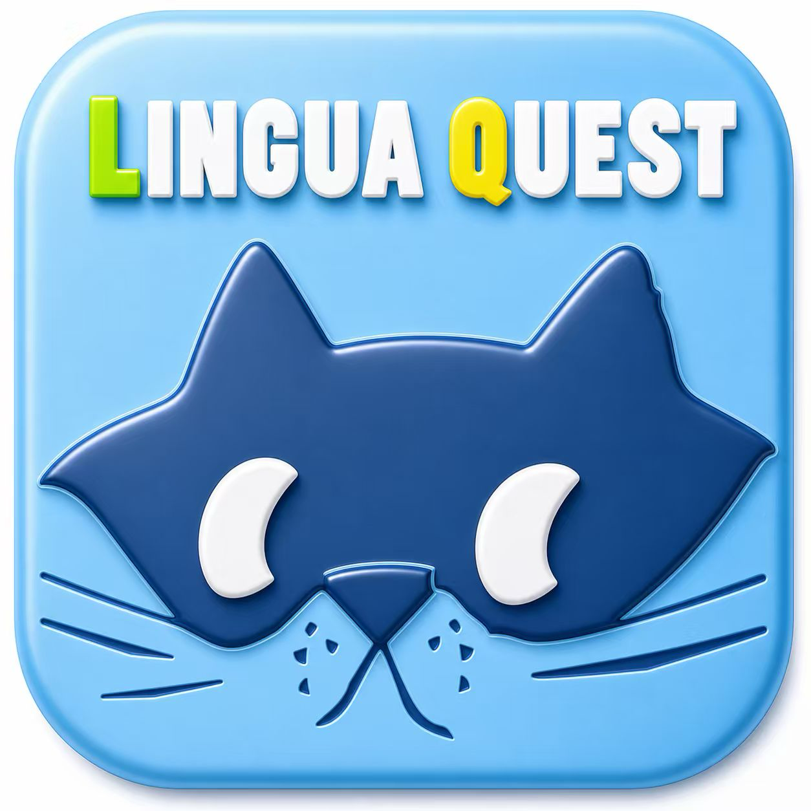
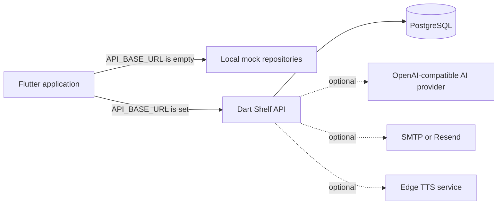

<h1 align="center">LinguaQuest</h1>

<p align="center">
  
</p>

<p align="center">
  <strong>Plan. Practice. Progress.</strong><br>
  An Android-first learning platform for structured vocabulary, reading, review, and AI-assisted practice.
</p>

<p align="center">
  <a href="https://flutter.dev"></a>
  <a href="https://dart.dev"></a>
  
  <a href="LICENSE"></a>
</p>

<p align="center">
  <a href="#capabilities">Capabilities</a> ·
  <a href="#architecture">Architecture</a> ·
  <a href="#getting-started">Getting started</a> ·
  <a href="#quality">Quality</a> ·
  <a href="#documentation">Documentation</a>
</p>

## Overview

LinguaQuest turns a learning goal into a daily loop: choose a scoped wordbook, study new material, practise retrieval, review weak items, and track progress. The repository combines a Flutter client, an optional Dart API, PostgreSQL persistence, and supporting services in one codebase.

The app works in two modes. With no API URL, local mock repositories provide a complete offline demo without backend-managed accounts, infrastructure, or secrets. With an API URL, the same client connects to the Shelf backend for persistent accounts, study data, social features, and optional remote services.

Study content currently covers Chinese HSK, Japanese JLPT, English, Spanish, French, and Malay collections. The product interface is currently fixed to English while localization infrastructure remains in the codebase.

## Capabilities

| Area | What is included |
| --- | --- |
| Guided learning | Goal setup, scoped study plans, learning paths, mixed study sessions, and daily targets |
| Practice and review | Quizzes, listening and spelling exercises, passage cloze, mistake book, weak-word review, and spaced repetition |
| Vocabulary and reading | Built-in wordbooks, search, custom-word CRUD, article reading, vocabulary capture, and pronunciation support |
| AI learning | Chat, sentence analysis and generation, cloze creation, writing review, reading explanations, and confusable-word practice |
| Motivation | XP, streaks, achievements, leaderboards, daily tasks, rewards, and cosmetic prize inventory |
| Community and discovery | Forum posts, likes, favorites, reports, public profiles, notifications, language map, and study spots |
| Learner controls | Progress analytics, recommendations, reminders, privacy settings, account data controls, light/dark themes, and accessibility-aware widgets |

## Architecture



The Flutter client selects mock or API-backed repositories at startup. In connected mode, the Shelf service owns authentication, learning records, rewards, community data, and AI policy; PostgreSQL stores durable state. AI, transactional email, and text-to-speech integrations are optional and configured on the server side.

### Technology map

| Layer | Primary technology |
| --- | --- |
| Client | Flutter, Dart, Material 3 |
| State and navigation | Riverpod, GoRouter |
| Networking and device services | Dio, local notifications, TTS/audio, maps, geolocation |
| API | Dart `shelf`, `shelf_router`, JWT authentication |
| Data | PostgreSQL, bundled JSON learning assets, local preferences |
| Optional integrations | OpenAI-compatible AI, SMTP/Resend email, Edge TTS |
| Delivery | Docker Compose, GitHub Actions, Android APK artifacts |

## Repository layout

```text
.
├── linguaquest/             # Flutter application, assets, and client tests
│   ├── lib/core/            # Routing, state, services, theme, and shared UI
│   ├── lib/data/            # Models, repositories, remote clients, and seed data
│   ├── lib/features/        # Product features grouped by domain
│   └── test/                # Unit, widget, regression, and accessibility tests
├── server/                  # Dart Shelf API and PostgreSQL integration
│   ├── bin/                 # Server entry point
│   ├── lib/src/             # Routes, policies, configuration, and persistence
│   ├── test/                # API, policy, provider, and data tests
│   ├── deploy/              # Production deployment assets
│   └── tts/                 # Optional text-to-speech service
├── docs/                    # Design, testing, release, and domain documentation
├── tools/                   # Data preparation and maintenance utilities
└── .github/workflows/       # Analyze, test, and Android build automation
```

## Getting started

### Prerequisites

- Flutter `3.41.6` with Dart `3.11.4`
- Android Studio or an Android SDK with an emulator/device
- Docker Engine with Docker Compose for connected mode

### Option A: offline demo

No backend or secrets are required. Repository access is required to clone this private project.

```bash
git clone https://github.com/VonLan233/LinguaQuest.git
cd LinguaQuest/linguaquest
flutter pub get
flutter run
```

Because `API_BASE_URL` is empty, the app automatically uses its mock repositories. This path is intended for UI development, demonstrations, and client tests.

Run `flutter devices` first if you want to select a specific Android emulator or device with `flutter run -d <device-id>`.

### Option B: local API and database

Start PostgreSQL and the API from the repository root:

```bash
cd server
docker compose up --build
```

This Compose file contains known development credentials and publishes the database and API ports. Use it only on a trusted development machine or local network; never deploy it to a public or shared host. Optional remote AI, email delivery, and TTS integrations require separate server configuration.

Confirm the API is healthy:

```bash
curl --fail http://localhost:8080/health
```

Expected response:

```json
{"status":"ok"}
```

In another terminal, run the client against the host service:

```bash
cd linguaquest
flutter pub get
flutter run --dart-define=API_BASE_URL=http://10.0.2.2:8080
```

`10.0.2.2` is the Android emulator alias for the host loopback interface. Use a reachable host address for a physical device.

## Configuration

The client has one compile-time setting:

| Setting | Required | Purpose |
| --- | --- | --- |
| `API_BASE_URL` | No | Empty selects offline mode; a URL selects API-backed repositories |

Server configuration is environment-based. [`server/.env.example`](server/.env.example) documents database credentials, JWT secrets, mail delivery, AI provider settings, CORS, and logging. Keep real secrets in ignored environment files or a secret manager; never commit them.

## Quality

The [CI workflow](.github/workflows/flutter-apk.yml) runs client analysis and tests, server tests, and a release-mode APK build before publishing the APK as an internal testing artifact. The current Android project still uses the example application ID and debug signing for release-mode builds, so this artifact is not ready for app-store submission.

Run the same core checks locally from the repository root:

```bash
(cd linguaquest && flutter analyze && flutter test)
(cd server && dart test)
```

## Build and deployment

Verify the project HTTPS endpoint, then build a connected release-mode APK:

```bash
export API_BASE_URL=https://api.vonlan233.top
curl --fail "$API_BASE_URL/health"

cd linguaquest
flutter build apk --release \
  --dart-define=API_BASE_URL="$API_BASE_URL"
```

If `API_BASE_URL` is omitted, the release build remains in offline mode. Android release builds should use HTTPS; do not ship a cleartext production API URL. The generated APK is currently intended for testing and sideloading only: configure a production application ID and release signing before store distribution.

Deployment, signing, and release guidance is indexed in [Documentation](#documentation).

## Documentation

| Document | Scope |
| --- | --- |
| [Flutter client guide](linguaquest/README.md) | Client modes, development commands, and release behavior |
| [Server operations guide](server/README.md) | API startup, configuration, Docker, and deployment |
| [Product blueprint](LinguaQuest_Product_Blueprint.md) | Product model, experience goals, and planning context |
| [Test plan](docs/testing/TEST_PLAN.md) | Test strategy, environments, and acceptance coverage |
| [Smoke-test guide](docs/release/smoke-test.md) | Release candidate verification |
| [Android release checklist](docs/release/android-release-checklist.md) | Packaging, signing, and distribution checks |
| [Screenshot guide](docs/screenshots/README.md) | Capture conventions and required store assets |

## Project status

LinguaQuest is under active development as a team project. Android is the primary delivery target; Flutter platform scaffolding for other targets is present but is not the current release commitment. Connected deployments require operator-managed secrets and infrastructure, while the default offline mode remains intentionally self-contained.

## Contributing

1. Create a focused branch from `dev`.
2. Keep changes scoped and include tests for non-trivial behavior.
3. Run client analysis, client tests, and server tests as applicable.
4. Include screenshots or recordings for visible UI changes.
5. Document new environment variables in `server/.env.example`.
6. Open a pull request with the user impact, verification evidence, and known limitations.

Team members can browse [open issues](https://github.com/VonLan233/LinguaQuest/issues) after signing in with repository access.

## License

LinguaQuest is licensed under the [GNU Affero General Public License v3.0](LICENSE). Review the license text for the terms that apply when using, modifying, or distributing the software.
