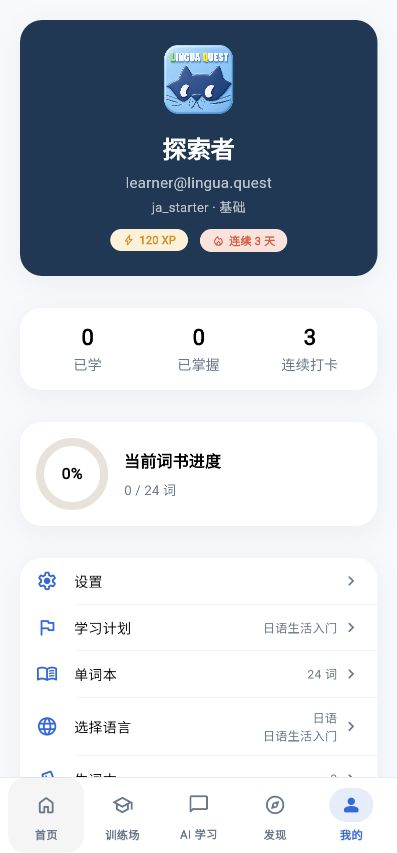
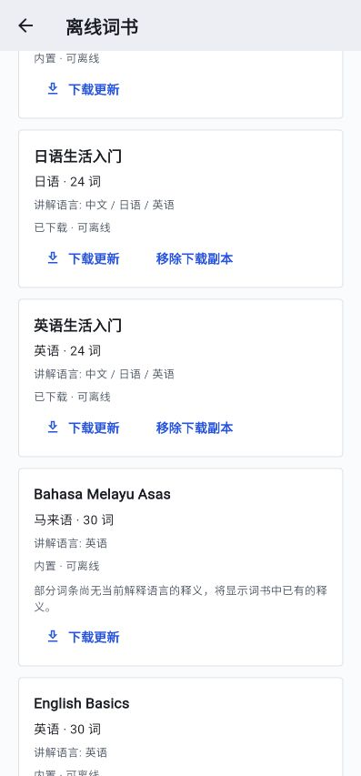
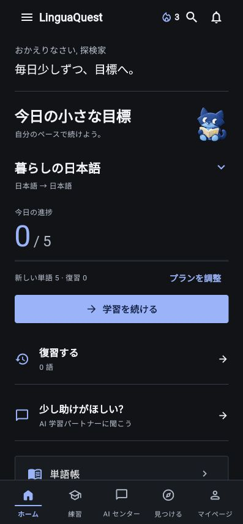
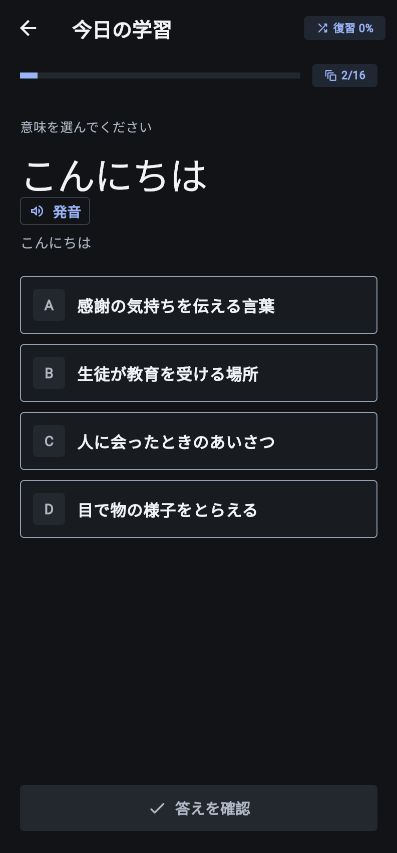
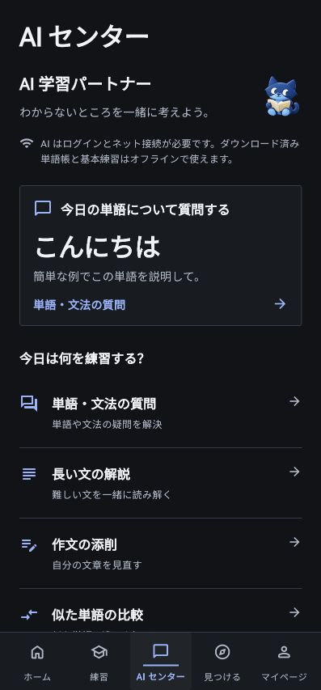
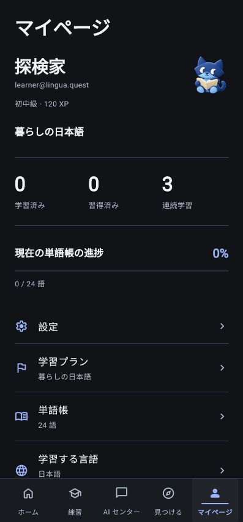
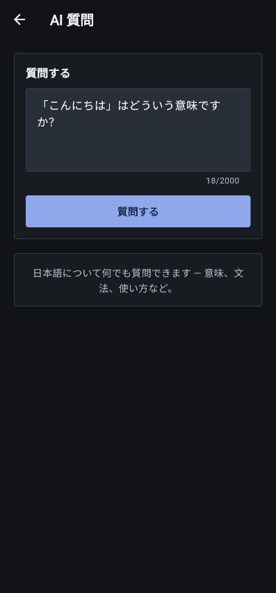

# LinguaQuest Swiss UI verification

Version: 1.3.0 (6). Branch: `codex/swiss-ui-language-books`.

The Flutter app now uses a Swiss-inspired typographic direction: left-aligned headings, a consistent content grid, large progress figures, flat controls, 4 px content corners, hairline separators and restrained blue. The existing smiling cat remains a small brand accent. Both light and dark themes use semantic colors; no font service or UI dependency was added.

## Audit and implemented corrections

1. **Home — verified:** reduced stacked tinted cards, emphasized the current book and daily progress, localized the default user name and retained single-line daily encouragement and primary learning access.
2. **Practice — verified:** prominent left-aligned word and meaning, flat answer choices, readable dark pronunciation controls and Japanese confidence labels. Explicit confirmation, feedback, retry, next and saved-session behavior remain covered by regression tests.
3. **AI center and tools — verified:** smaller mascot, clear tool rows, current-word entry and truthful account/network notice. Six tool forms, feedback sections, validation, generated question drafts and history controls now use localized Chinese, Japanese and English UI strings.
4. **Profile — verified:** removed the large navy identity panel and rounded statistic cards. Active-book titles resolve through the explanation locale, progress is scoped to the current book and long setting values align beneath their labels.
5. **Wordbooks — verified:** language selection remains independent of explanation language. The offline catalog can filter all learning languages, shows actual definition-language coverage and explains missing translations. Large word lists build visible rows on demand.

### Evidence

The following screenshots were captured from the running Flutter app during this change, rather than a separate mockup. They show a 397 px browser viewport; widget tests additionally cover 360 px layouts and enlarged text. Screenshots alone do not establish complete accessibility compliance or verify spoken audio output.

Before, the profile exposed a raw book ID and used a large decorative panel:



After, the same Chinese/light profile uses a compact identity and a consistent grid:


Chinese/light Home and multilingual offline catalog:




Current Japanese dark-mode screens:







## Language and learning behavior

- The explanation/UI language and learning language support all nine Chinese, Japanese and English combinations. Switching explanation language keeps the selected wordbook.
- Three 24-word starter books contain complete Chinese, Japanese and English definitions. The existing 21-book catalog remains available. Legacy exam books can lack some translations; the UI discloses that limitation and retains their source definitions.
- Daily review and weak-word queues filter records by the active book **before** deduplicating headwords. This preserves separate schedules for an identical word in multiple books. Complete history remains available. Legacy personal cards without a source-book association remain general practice.
- Live browser check: downloaded the English starter book while the Japanese study book remained selected; the English book changed to “Downloaded · available offline”.
- Downloaded JSON, local progress, offline replay and account separation use the existing stores. Basic text learning and review work offline. AI requires an account and network access; online audio also needs a connection.

## Validation

- Local full Flutter suite: **737 passed**.
- Static analysis: no issues.
- Additional focused AI tests after correcting localized question initialization: **25 passed**. Current-word prompts initialize after localization dependencies are ready and do not overwrite typed text on rebuild.
- Layout checks cover all nine language pairs in light/dark Home screens; profile/settings cover all nine pairs at 360 px with 1.3× text; six AI tools render in three locales at 360 px in dark mode.
- Wordbook tests cover a 2,500-word book, independent offline catalog filtering, and cross-language / same-language book review isolation.
- Build uses the configured production API. No server deployment or production data changes were necessary for this UI change.

CI: all three jobs succeeded, including Flutter tests/analysis, server tests/compilation and Android packaging.

The CI source commit was `20247a1`. After grouping dependent theme/page changes into one atomic UI commit, the source commit is `91bd186`. The application and workflow Git tree objects are identical: `d3aa4edbc330ffbe4e67ac7049edd248cc00254d` (`linguaquest/`) and `8a7e31d963da66379df9bd18ea9bb79b4c1beb39` (`.github/`). No application files changed during this history cleanup.

CI and Android delivery: [Flutter APK run](https://github.com/VonLan233/LinguaQuest/actions/runs/39223232636).

The Android verification package is named **LinguaQuest Swiss**, with application ID `com.example.linguaquest.swiss`, to preserve the existing installed apps and their data when CI signing keys differ.

Installed and checked on the connected Android phone: version 1.3.0, build 6. Original 1.1.0 (4) and previous preview 1.2.0 (5) remain installed. In the Swiss guest profile, switching from HSK 1 to the Japanese starter updated the book and language pair. Native dark-mode Home, AI center and question layouts fit the screen. A confirmed answer was saved, the app was force-stopped and relaunched, and resuming restored the same confirmed-feedback state at question 2/31. No notification permission was granted.

Swiss APK SHA-256: `d1b28b6e9005d65d8e0745364be48f78e188e9695d0c59d25d333811fae77515`.

## Reproduce

From `linguaquest/`:

```sh
flutter test
flutter analyze
flutter build web --release --dart-define=API_BASE_URL=https://api.vonlan233.top
python3 -m http.server 4175 --bind 127.0.0.1 --directory build/web
```

Open `http://localhost:4175/`. Enter guest mode, choose a book, then change explanation language and theme in Settings to inspect the combinations.
