# 三个英语学习产品 UI、交互、视觉与产品逻辑分析报告

分析重点分为五层：

| 层级    | 关注内容                             |
| ----- | -------------------------------- |
| 产品逻辑  | 产品认为用户为什么会学习、每天应该被引导做什么、如何形成长期使用 |
| 信息架构  | 一级导航、二级入口、内容组织、功能权重              |
| 交互链路  | 从打开 App 到开始学习、完成学习、复习、查看数据的路径    |
| 视觉与美术 | 色彩、字体、插画、卡片、空间、按钮、图标、氛围、品牌识别     |
| 工程含义  | 前端状态、组件形态、后端数据对象、学习记录、复习队列、运营配置  |

三款产品的核心差异可以先概括为：

| 产品   | 产品底层逻辑                   | 视觉气质             | 学习机制                     |
| ---- | ------------------------ | ---------------- | ------------------------ |
| 不背单词 | 把背词做成安静、低压力、可长期坚持的个人学习空间 | 柔和、留白、浅色、低干扰     | 语境解释 + 主动回忆 + 个性化设置      |
| 扇贝   | 把背词做成目标明确、可运营、可打卡的学习计划系统 | 薄荷绿、渐变、任务卡、运营活动感 | 用户建档 + 任务量 + 自评掌握 + 打卡反馈 |
| 百词斩  | 把背词做成图像记忆和游戏化训练体验        | 蓝色、插画、地图、强图形识别   | 图片联想 + 选择判断 + 训练场 + 社交游戏 |

## 1. 不背单词

### 1.1 截图与页面覆盖

<table>
<tr>
<td width="25%">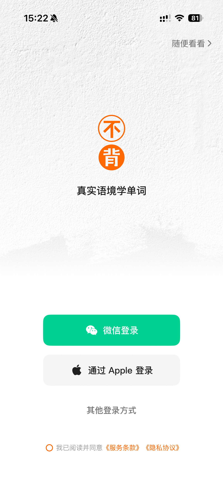<br><strong>登录页</strong></td>
<td width="25%">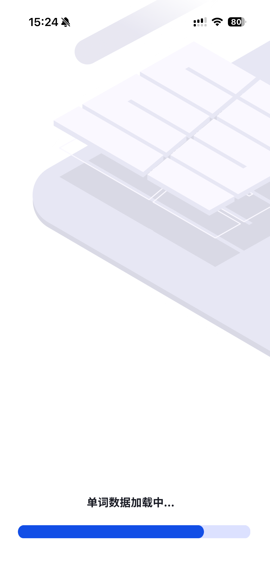<br><strong>背词前加载</strong></td>
<td width="25%">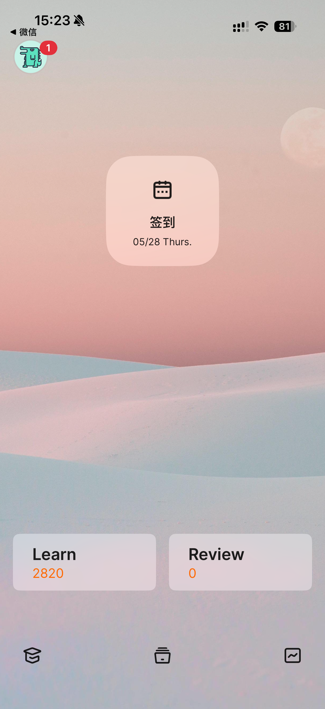<br><strong>主页</strong></td>
<td width="25%">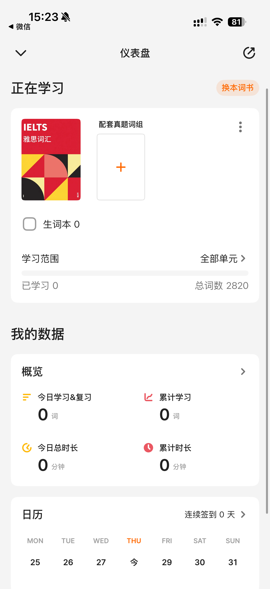<br><strong>仪表盘</strong></td>
</tr>
<tr>
<td width="25%">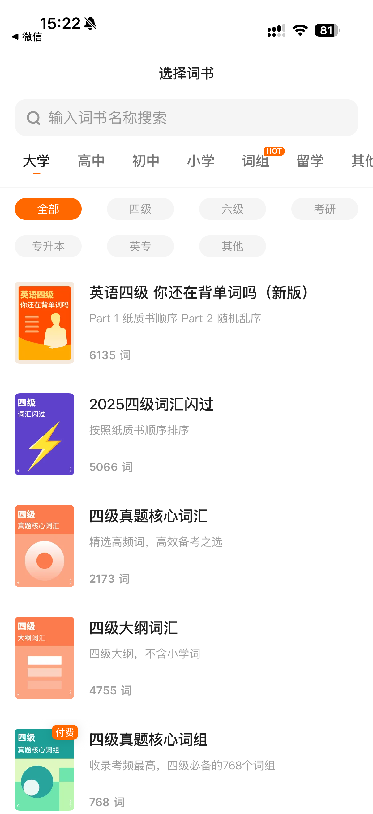<br><strong>选择单词书</strong></td>
<td width="25%">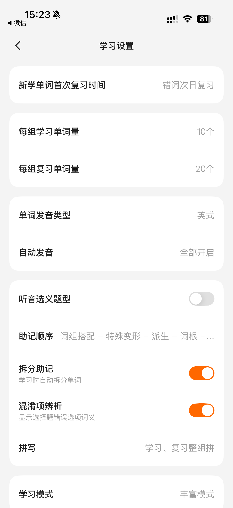<br><strong>学习设置</strong></td>
<td width="25%">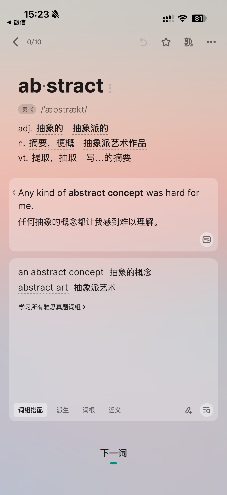<br><strong>单词展示</strong></td>
<td width="25%">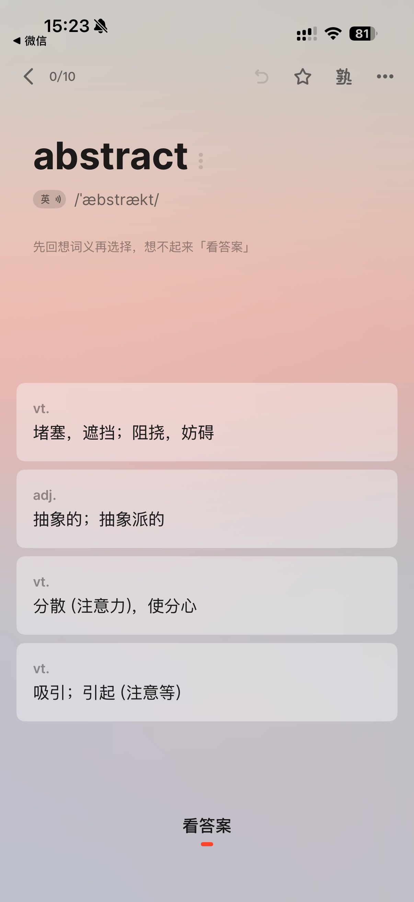<br><strong>背单词判断</strong></td>
</tr>
<tr>
<td width="25%">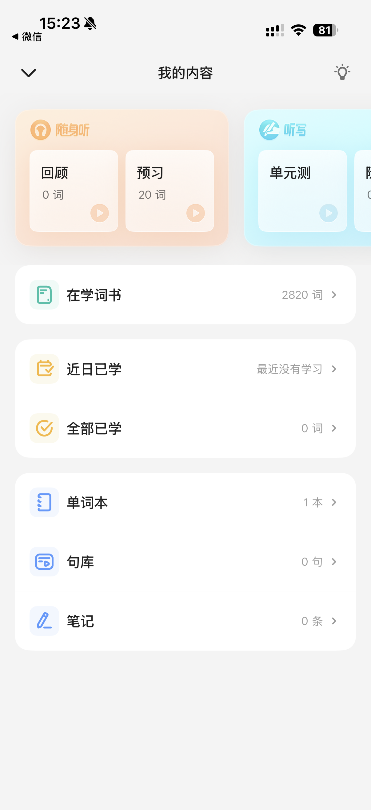<br><strong>我的内容</strong></td>
<td width="25%">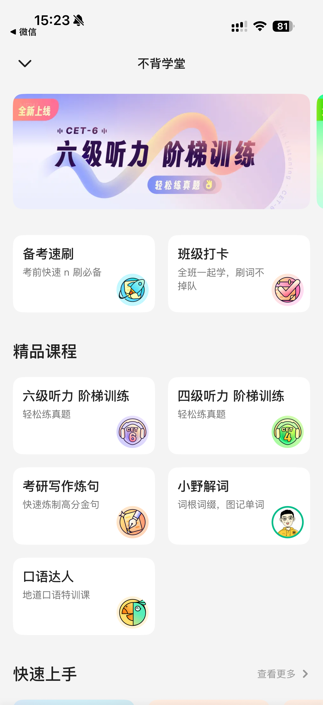<br><strong>课堂</strong></td>
<td width="25%">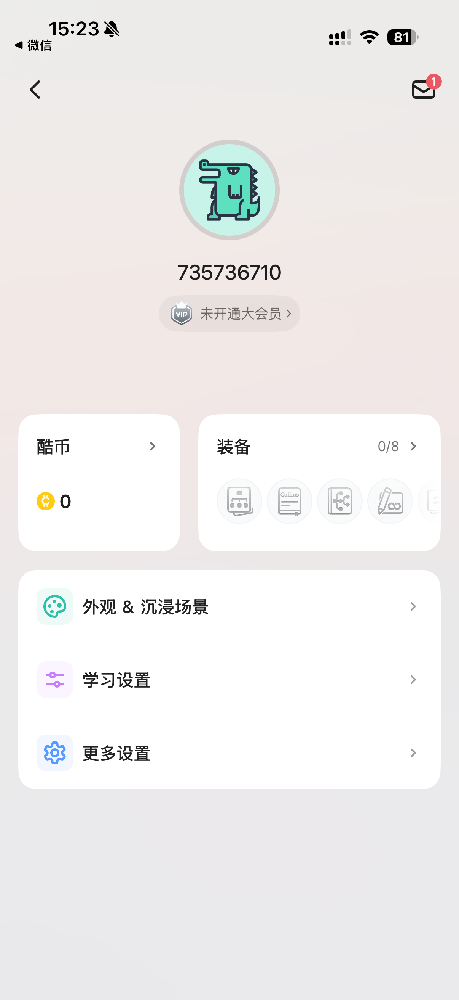<br><strong>个人页面</strong></td>
<td width="25%">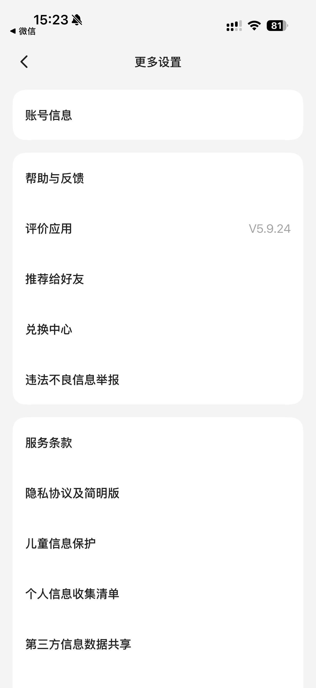<br><strong>更多设置</strong></td>
</tr>
</table>

### 1.2 产品逻辑

不背单词的产品逻辑是“让用户以很低的心理负担开始一次个人学习”。它没有把首页做成内容平台，也没有在第一屏堆叠课程、商城、活动、社区，而是把最重要的两件事放在底部：`Learn` 和 `Review`。主页中央是签到，底部是新学与复习，这形成一种很安静的日常仪式感。

`主页` 和 `dashboard` 的关系很明确。主页负责“现在开始”，仪表盘负责“解释进度”。仪表盘里有正在学习的词书、配套真题词组、生词本、学习范围、今日学习与复习、累计学习、今日时长、累计时长、日历和连续签到。也就是说，不背单词没有把数据藏起来，但它把数据从启动页中移开，避免用户一打开 App 就被复杂信息打断。

`选择单词书` 页面把词书按大学、高中、初中、小学、词组、留学、其他等标签分类，并以列表方式呈现书名、封面和词量。这里的产品思路更接近“书架”而不是“课程市场”：词书是学习的基本单位，用户选择一本词书后，后续所有学习、复习、词组和数据都围绕这本书展开。

`我的内容` 页面进一步说明它把学习材料分成几个个人资产：随身听、听写、在学词书、近日已学、全部已学、单词本、句库和笔记。它不是只记录“已背多少词”，而是把听、写、词书、句子、笔记都放在一个学习资料库里。这种设计把背词扩展成个人知识管理，但又不在首页暴露过多入口。

### 1.3 交互与使用链路

不背单词的主要链路可以还原为：

```text
登录 -> 加载词库 -> 主页 Learn/Review -> 单词展示 -> 主动回忆/选择释义 -> 下一词 -> 数据沉淀到仪表盘和我的内容
```

`背单词之前的loading` 页面不是简单转圈，而是用插画和进度条表达“单词数据加载中”。这说明学习 session 不是一个静态页面，而是系统先根据词书、任务量、复习规则和用户设置生成一组学习数据，再进入正式学习。

核心学习页面有两种状态。`核心页面-单词展示` 是完整解释态，显示 `ab·stract` 的拆分、发音、词性、多义项、例句、翻译、词组搭配，并提供“词组搭配、派生、词根、近义”等切换。`核心页面-背单词` 则是回忆态，页面提示“先回想词义再选择，想不起来看答案”，下方给多个词义选项。这个顺序说明它强调 retrieval practice：不是一开始就看答案，而是先让用户主动检索。

顶部工具栏包括返回、进度 `0/10`、撤销、收藏、熟词标记、更多操作。这些控件体现了学习 session 的状态管理：用户可以退出、收藏、标熟、撤回、打开更多设置。底部的“下一词”和“看答案”是主操作，按钮位置稳定，适合连续单手操作。

`学习设置` 页面把每组新词、每组复习词、发音类型、自动发音、听音选择题、助记顺序、拆分助记、混淆项辨析、拼写、学习模式等都开放出来。这个设置体系说明不背单词的学习流程不是固定脚本，而是由多个开关控制题型、提示、音频和复习方式。

### 1.4 视觉、美术与界面风格

不背单词的视觉主轴是低饱和、柔和、沉浸。`主页` 使用粉蓝渐变风景作为整屏背景，背景不是强主题插画，而像一张柔焦壁纸。视觉上它刻意弱化边界和噪声，让用户进入一种私人空间感。中央签到卡和底部 `Learn` / `Review` 卡片都有半透明质感，边缘圆角大，接近磨砂玻璃效果。

色彩上，不背单词没有使用大面积高饱和主色。它的强调色主要是橙色和青绿色：橙色用于数字、开关、提示和当前日期；青绿色用于学习进度或小型状态标记。这种配色不会制造紧张感。与百词斩的高刺激蓝色游戏界面相比，不背单词更像一个情绪稳定的学习工具。

字体风格很有特点：英文单词使用极粗黑体、大字号、低装饰，中文释义也保持较大字号。`核心页面-单词展示` 中 `ab·stract` 占据了页面上方主要视觉权重，单词本身成为画面主角，而不是图片或卡通角色。音标、标签、词性用浅灰降低权重，释义和例句用更高对比度。这种排版非常适合“读”和“记”，不是以点击刺激为中心。

卡片系统非常统一。仪表盘、我的内容、学习设置、个人页面、更多设置都使用白底圆角卡片，加灰色页面背景。卡片之间留白明显，分组关系清楚。不同功能模块依靠图标色块、标题、右箭头和数字状态区分，不依赖复杂插画。整体视觉负担低，但也意味着页面的情绪峰值较少。

`登录页` 使用白色纸纹背景和中心品牌符号，底部是微信、Apple 和其他登录方式。它没有强运营标语，也没有大幅广告图。登录按钮的绿色是全页最显眼的颜色，说明登录页的视觉目标非常单一：让用户进入学习，而不是先建立复杂品牌叙事。

`课堂` 页面是一个例外，它出现了更丰富的彩色 banner、课程卡片和活动入口，但整体仍然保持白底卡片和柔和图标。它像主学习流程外的内容扩展区，不会改变核心背词页面的安静气质。

### 1.5 前端与后端可观察到的工程结构

从前端角度，不背单词由几个明显的页面状态组成：登录态、词库加载态、学习主页态、仪表盘态、学习 session 态、设置态、个人内容态。学习 session 内部至少包含“展示解释”“回忆答题”“看答案”“下一词”“收藏/标熟/撤销”等状态。由于用户可以调整题型和助记顺序，前端需要根据用户配置动态渲染不同学习组件。

组件层面反复出现的是：大卡片、设置列表、开关、横向内容卡、词书列表、底部导航、顶部学习工具栏、单词解释卡、选项卡片、学习进度。它的组件复杂度不来自视觉特效，而来自状态组合。

从后端角度，截图暴露出的数据对象包括：用户账号、当前词书、词书单元、单词、词组、例句、派生/词根/近义数据、学习设置、生词本、句库、笔记、学习 session、学习记录、复习队列、签到日历、累计时长。`学习设置` 中每个开关都会影响 session 生成逻辑，因此后端或本地存储需要保存学习偏好，并在生成每日任务时读取。

不背单词的数据关系更像“用户 - 词书 - 单词知识节点 - 学习记录”。它没有在截图中强推社交关系和奖励经济，因此后端复杂度主要集中在词汇内容、复习调度、学习统计和用户个性化配置上。

## 2. 扇贝

### 2.1 截图与页面覆盖

<table>
<tr>
<td width="25%">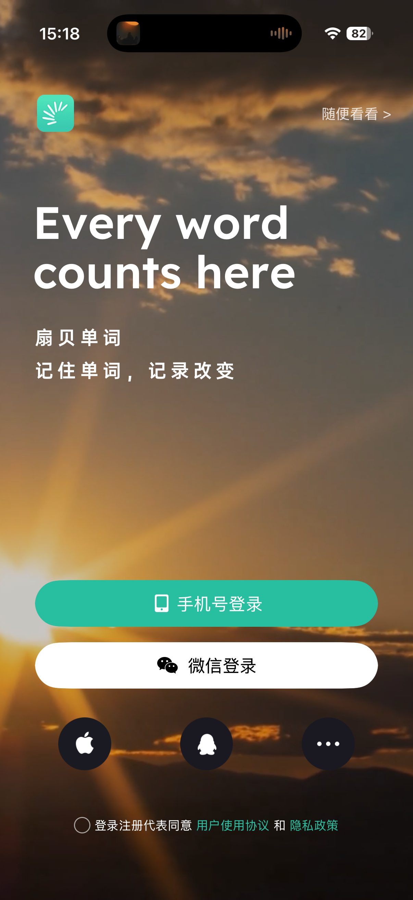<br><strong>登录页</strong></td>
<td width="25%">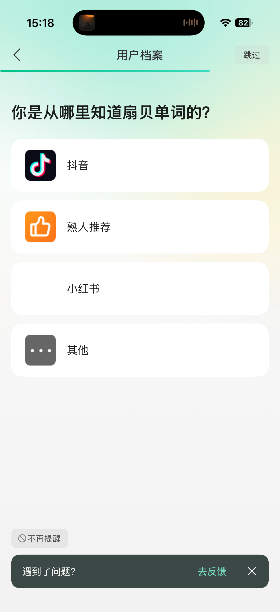<br><strong>用户来源调查</strong></td>
<td width="25%">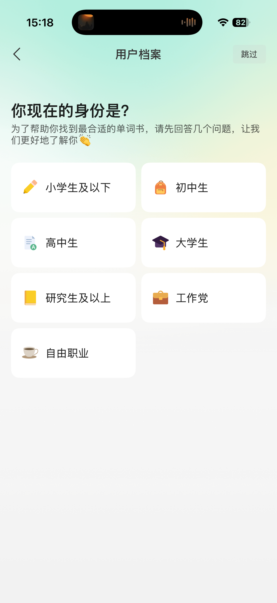<br><strong>新用户选身份</strong></td>
<td width="25%">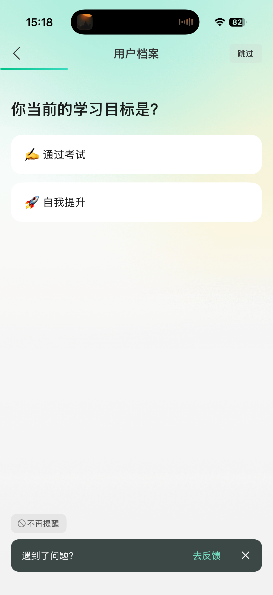<br><strong>新用户选目的</strong></td>
</tr>
<tr>
<td width="25%">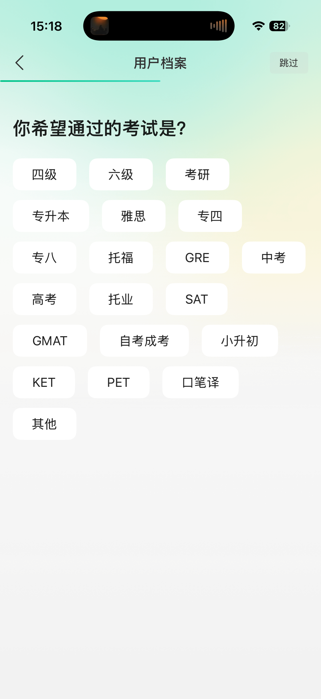<br><strong>新用户选目标</strong></td>
<td width="25%">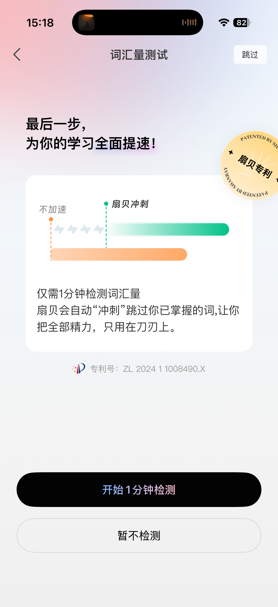<br><strong>词汇量测试</strong></td>
<td width="25%">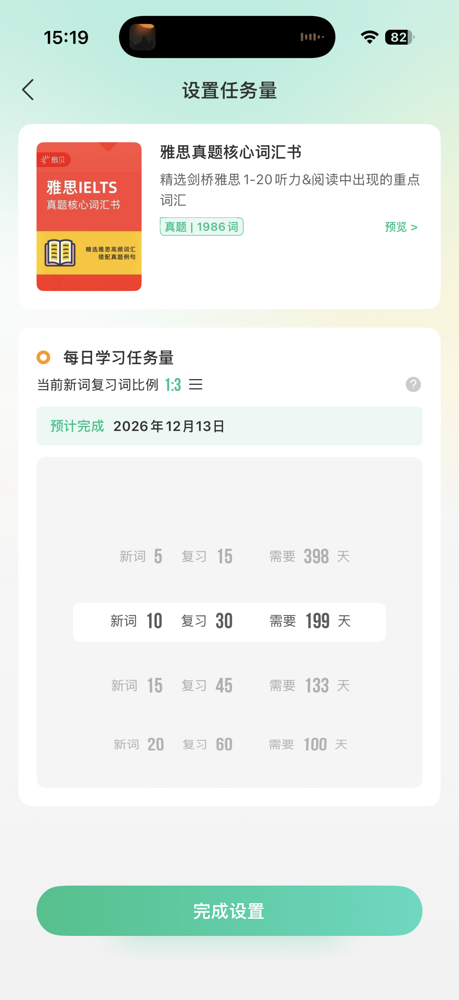<br><strong>设置任务量</strong></td>
<td width="25%">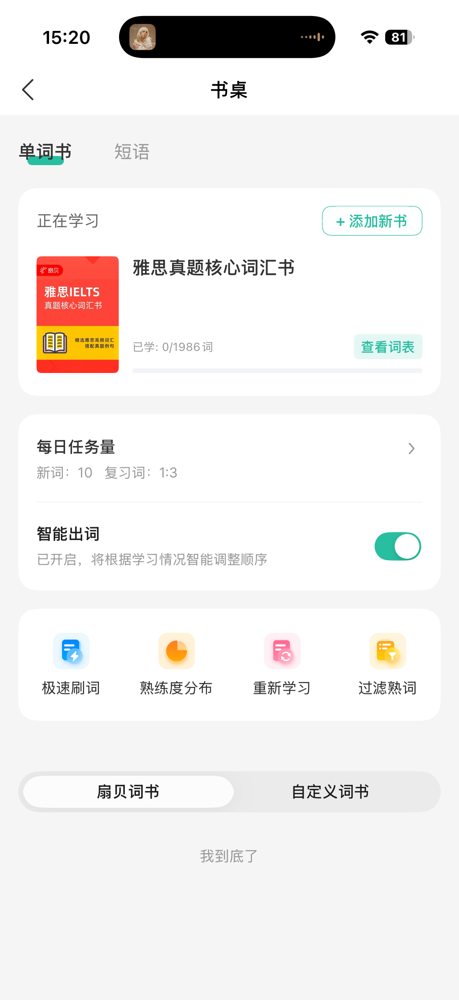<br><strong>单词书设置</strong></td>
</tr>
<tr>
<td width="25%"><br><strong>单词页首页</strong></td>
<td width="25%">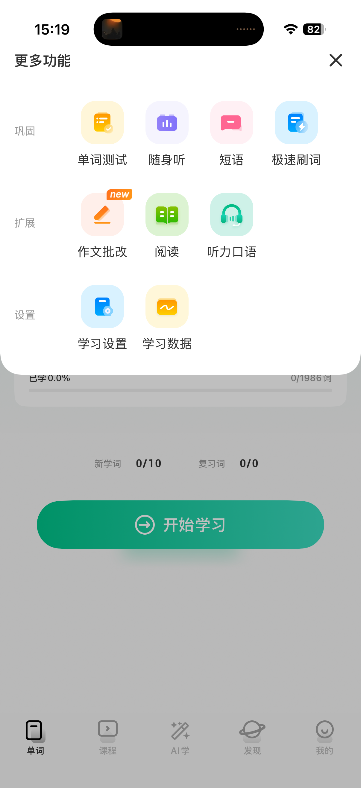<br><strong>顶部下拉菜单</strong></td>
<td width="25%">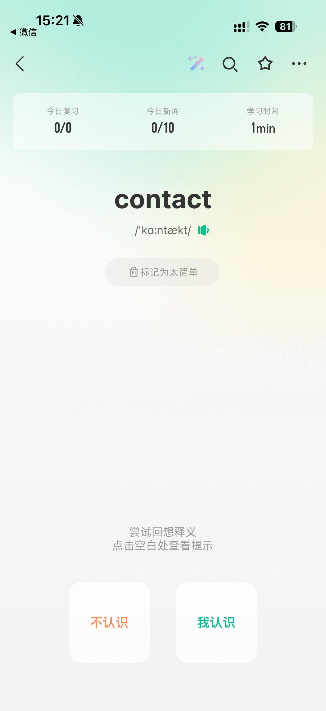<br><strong>背单词判断</strong></td>
<td width="25%">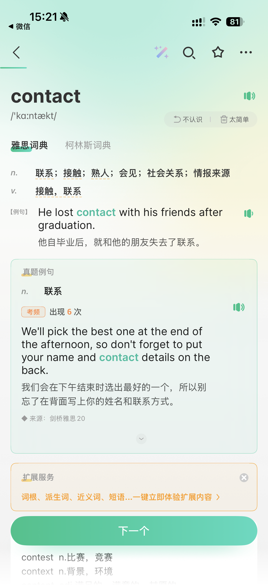<br><strong>单词展示</strong></td>
</tr>
<tr>
<td width="25%">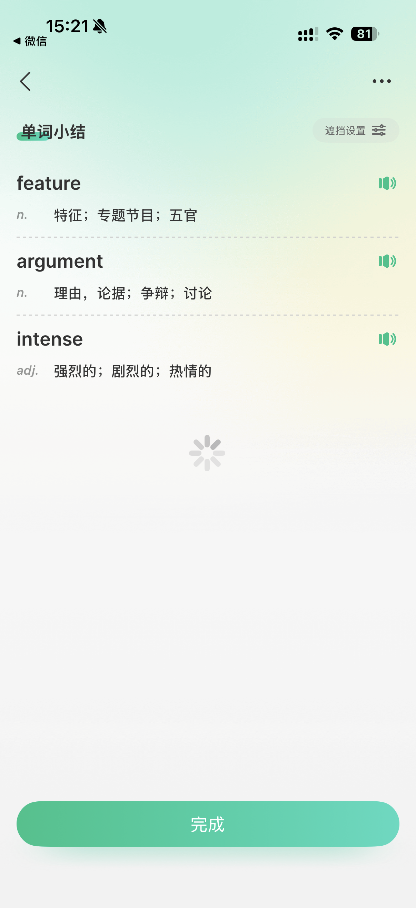<br><strong>单词小结</strong></td>
<td width="25%">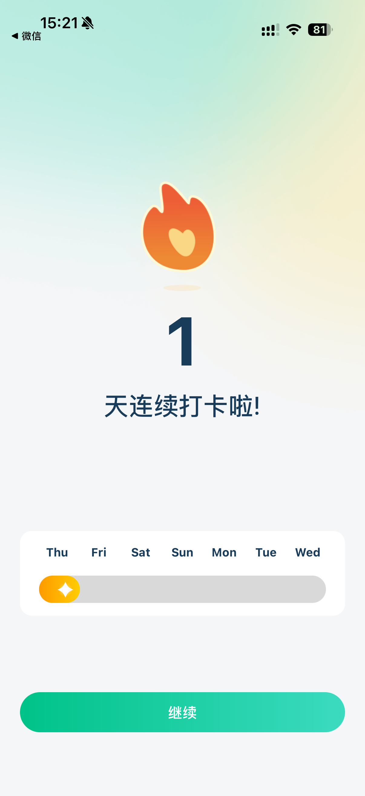<br><strong>完成后打卡</strong></td>
<td width="25%">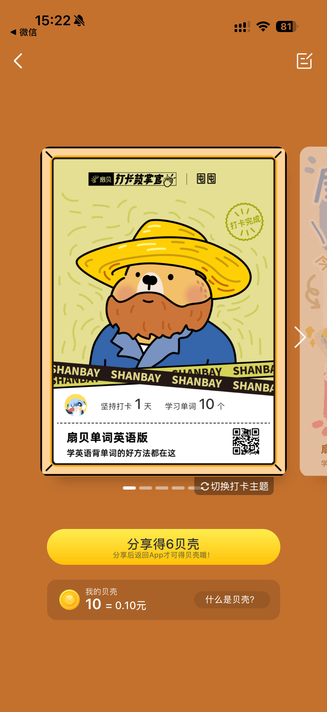<br><strong>分享海报</strong></td>
<td width="25%">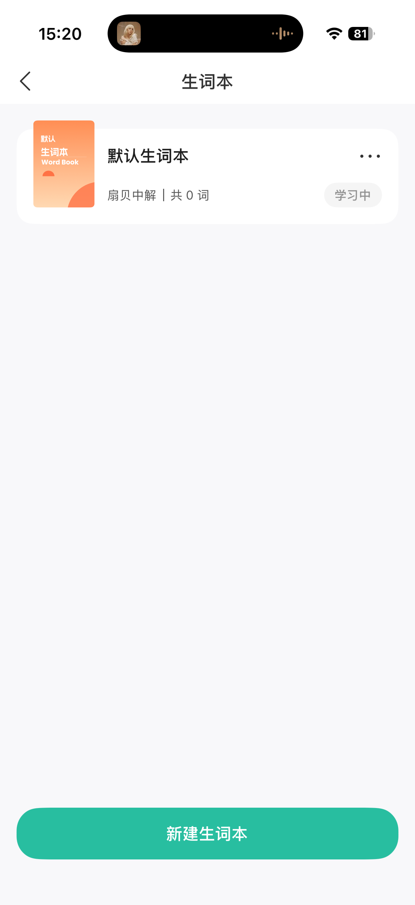<br><strong>生词本</strong></td>
</tr>
<tr>
<td width="25%"><br><strong>发现页</strong></td>
<td width="25%">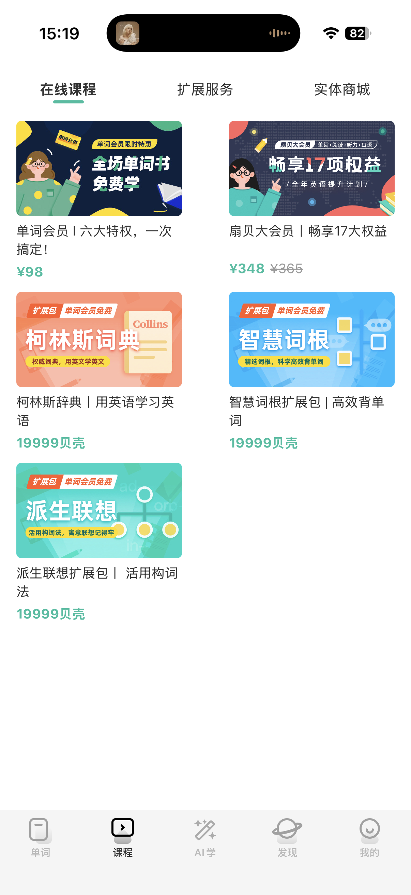<br><strong>课程页</strong></td>
<td width="25%">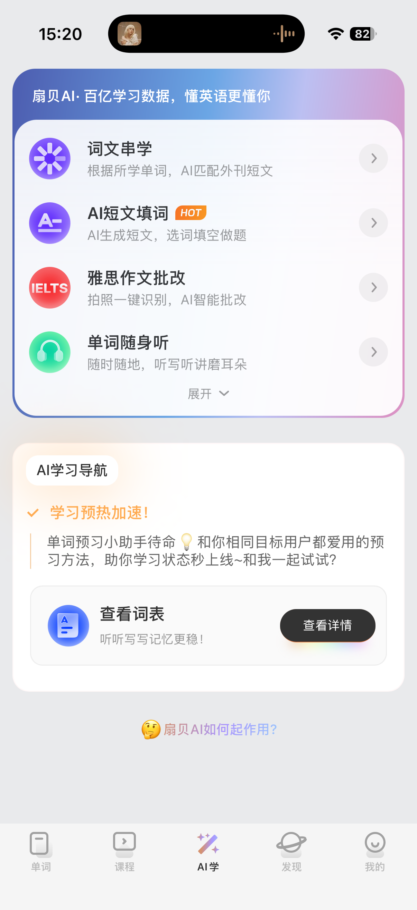<br><strong>AI 学习</strong></td>
<td width="25%">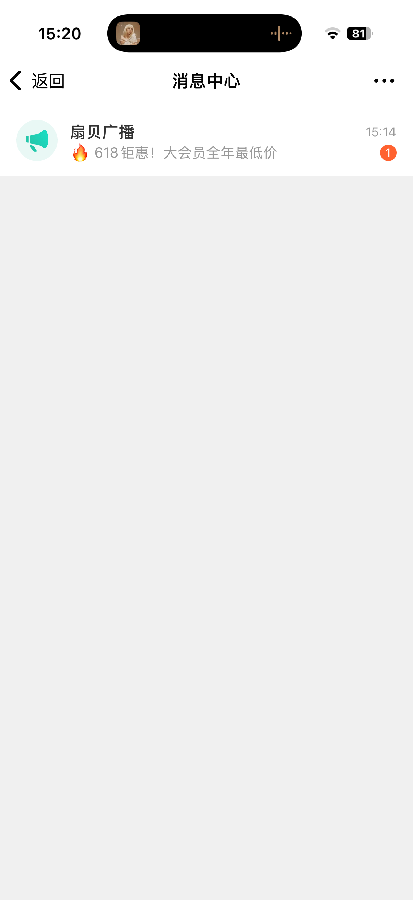<br><strong>消息</strong></td>
</tr>
<tr>
<td width="25%">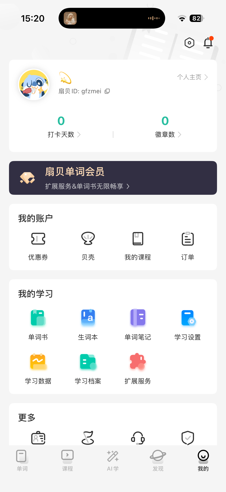<br><strong>我的</strong></td>
<td width="25%">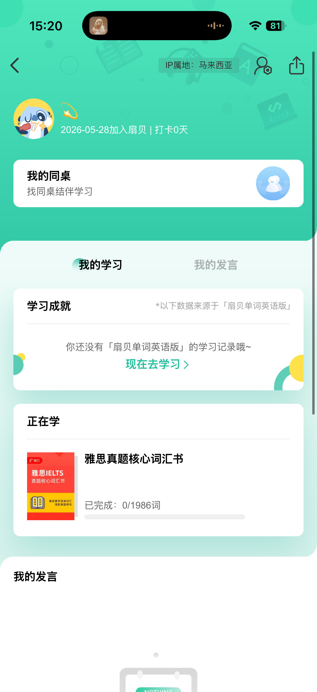<br><strong>个人主页</strong></td>
<td width="25%">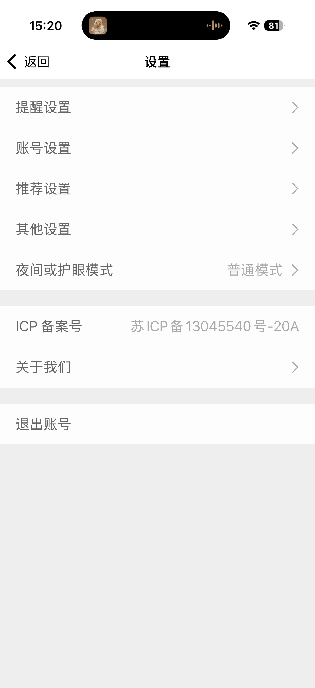<br><strong>设置</strong></td>
<td width="25%"></td>
</tr>
</table>

### 2.2 产品逻辑

扇贝的产品逻辑是“先识别用户目标，再把学习变成一套可运营的每日任务”。它比不背单词更重视新用户建档，截图中连续出现了用户来源调查、身份选择、目的选择、考试目标选择、词汇量测试、任务量设置和单词书设置。这说明扇贝不是让用户直接进入一本词书，而是先把用户分层。

`新用户选身份` 问的是用户所处阶段，`新用户选目的` 问的是学习目标，`新用户选目标` 问的是具体考试。这个链路把用户从宽泛人群逐步映射到具体学习场景。`词汇量测试` 则是能力诊断，它把主观目标和客观水平连接起来。`设置任务量` 再把目标转化为每日新词、复习量和时间安排。

`单词页 首页` 的结构也服务于计划感。顶部有查词、翻译、润色等搜索入口，中间显示打卡天数、当前词书、学习进度、新学词和复习词数量，底部是大号“开始学习”按钮。它不是情绪化的学习空间，而是一个清楚的任务控制台。

底部导航包括 `单词`、`课程`、`AI学`、`发现`、`我的`。这说明扇贝已经不是单一背词工具，而是包含词书学习、课程内容、AI 功能、运营活动、账号数据的学习平台。背单词仍然是入口之一，但不是唯一业务。

### 2.3 交互与使用链路

扇贝的主链路可以还原为：

```text
登录 -> 用户档案 -> 目标/水平/任务量 -> 单词首页 -> 开始学习 -> 认识/不认识 -> 查看词条 -> 单词小结 -> 打卡/分享/发现页任务
```

核心学习交互的第一步是自评。`核心页面-背单词` 中，用户看到单词 `contact`、音标、发音、今日复习/新词/学习时间，然后下方出现“不认识”和“我认识”。这里系统不是先考用户四选一，而是先收集用户主观掌握状态。这个交互更接近复习算法的数据入口：认识、不认识、太简单、不认识等状态会影响后续复现频率。

`核心页面-单词展示` 是解释态。它包括词典切换、词性、释义、例句、真题例句、考频、来源、扩展服务和下一词。页面中出现“太简单”“不认识”等快捷操作，说明用户在看解释时仍然可以继续反馈掌握度。顶部还有魔法棒、搜索、收藏、更多入口，功能密度高于不背单词。

`背完单词的小节` 把刚学过的词列出来，例如 feature、argument、intense，并配有发音按钮。它不是直接跳到奖励页，而是先做学习内容回顾。之后 `完成后的打卡页面` 用大号火焰图标、连续打卡天数和周进度条给完成反馈。再往后，`分享海报页面` 把坚持天数、学习单词数和品牌信息包装成可传播海报。

`发现页` 将每日签到、扇贝单词完成打卡、词汇量测试、会员补给、体验功能等任务放进活动列表。这是学习完成后的运营承接。`课程页` 和 `AI学习` 则把用户从单词学习引向更高层次内容服务。

### 2.4 视觉、美术与界面风格

扇贝的视觉主轴是薄荷绿、浅渐变、圆角卡片和平台任务感。它大量使用浅绿色到浅黄色的柔和渐变背景，这种颜色既有“清新学习”的心理暗示，也比纯白页面更有品牌记忆。与不背单词的粉蓝沉浸背景不同，扇贝的渐变更像功能界面的底色，它不抢内容，但持续强调品牌色。

`登录页` 使用真实风景图作为背景，并叠加英文标语 `Every word counts here`。这页的视觉情绪比不背单词更强，强调“开始一段学习旅程”。按钮是绿色主按钮配白色辅助登录按钮，底部还有登录协议和多登录方式。品牌气质是清爽、现代、轻社交。

Onboarding 页面是扇贝视觉系统最统一的一组。`用户来源小调查`、`新用户选身份`、`新用户选目的`、`新用户选目标` 都使用顶部返回与跳过、进度线、大标题、白色圆角选项按钮。选项按钮面积大、间距宽，减少填写问卷的压迫感。背景渐变从顶部浅绿过渡到底部白色，给流程一种轻量感。页面虽然在收集信息，但视觉上不会像表单。

`词汇量测试` 页面用黑色底部主按钮和中部进度/对比条增强测试感。这里的颜色从绿色系统中短暂切换出来，强调“测评”是一个更正式的动作。`设置任务量` 页面继续使用词书卡片、数字选择器和绿色确认按钮，任务量被做成可配置计划，而不是简单输入框。

学习页的视觉非常克制。`核心页面-背单词` 中，单词居中，顶部数据卡片弱化，底部两个白色按钮给出判断。页面底色依旧是浅绿到浅黄渐变，但中心区域留白极多，制造“回想释义”的空间。`核心页面-单词展示` 信息密度明显变高，但通过绿色高亮、橙色考频、浅色扩展卡片、底部大按钮保持层次。

`发现页` 的视觉风格明显更运营化：黄色活动大卡、彩色图标、哭脸吉祥物、抽奖碎片、绿色行动按钮、侧边规则与反馈浮条。这一页与单词学习页的克制形成对比，说明扇贝把学习和运营活动分成不同视觉语境。学习页安静，发现页活跃。

`分享海报页面` 使用高饱和橙棕色背景和大幅卡片式海报。它的视觉目的不是学习，而是传播：二维码、学习天数、学习单词数、品牌口号、分享奖励全部在一屏内出现。页面中“分享得 6 贝壳”按钮极其醒目，商业和增长意图强。

`我的`、`个人主页`、`设置` 使用标准白底列表卡片。个人页顶部统计学习天数、累计学习、已学单词、词汇量等，用图标和数字建立成就感。设置页则完全回到工具型列表，视觉上低干扰，说明功能设置在扇贝里是后台性质的页面。

### 2.5 前端与后端可观察到的工程结构

从前端角度，扇贝的复杂度明显来自多业务模块：onboarding wizard、词汇量测试、任务量选择器、词书设置、单词学习 session、单词详情、单词小结、打卡反馈、分享海报、发现页任务、课程页、AI 学习、消息、个人中心和设置。

它的组件体系包括：问卷选项按钮、进度条、词书卡片、数字选择器、底部大按钮、学习判断按钮、词典切换 tab、例句卡片、扩展服务卡片、打卡周进度、活动任务卡、课程卡、消息列表、个人统计卡、设置列表。与不背单词相比，扇贝的前端要处理更多业务入口和更强的运营配置。

从后端角度，扇贝暴露出的数据对象包括：用户来源、身份、学习目的、考试目标、词汇量测试结果、每日任务量、词书订阅、词书进度、学习 session、单词掌握状态、认识/不认识反馈、生词本、打卡记录、连续天数、分享海报、奖励货币、发现页任务、课程内容、AI 学习入口、消息通知、会员状态。

扇贝的后端关系不仅是“用户学了哪些词”，还包括“用户是谁、为什么学、每天学多少、是否完成任务、是否参与活动、是否分享、是否进入课程或会员链路”。它呈现出典型学习平台的数据结构：学习数据、用户画像、运营活动、内容商品和消息系统同时存在。

## 3. 百词斩

### 3.1 截图与页面覆盖

<table>
<tr>
<td width="25%">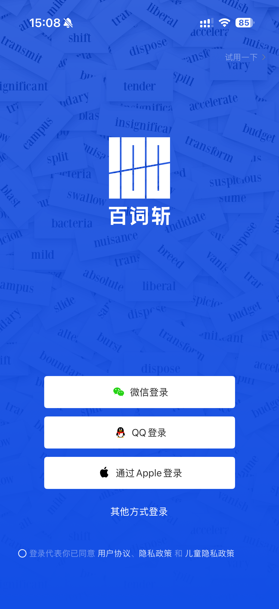<br><strong>登录页</strong></td>
<td width="25%">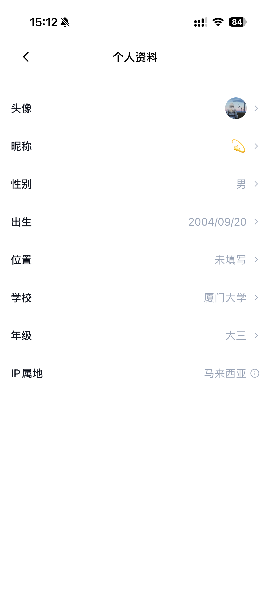<br><strong>资料编辑</strong></td>
<td width="25%">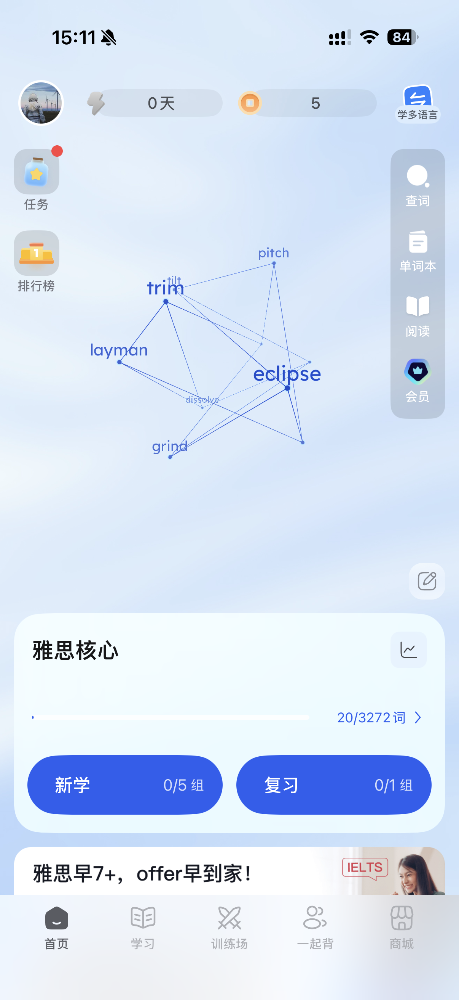<br><strong>首页</strong></td>
<td width="25%">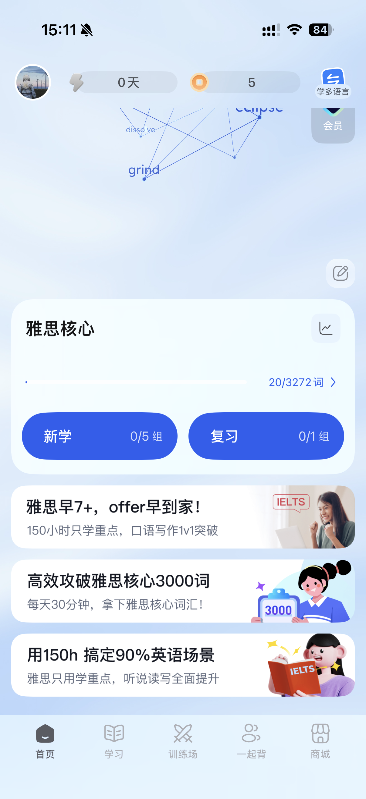<br><strong>首页 2</strong></td>
</tr>
<tr>
<td width="25%">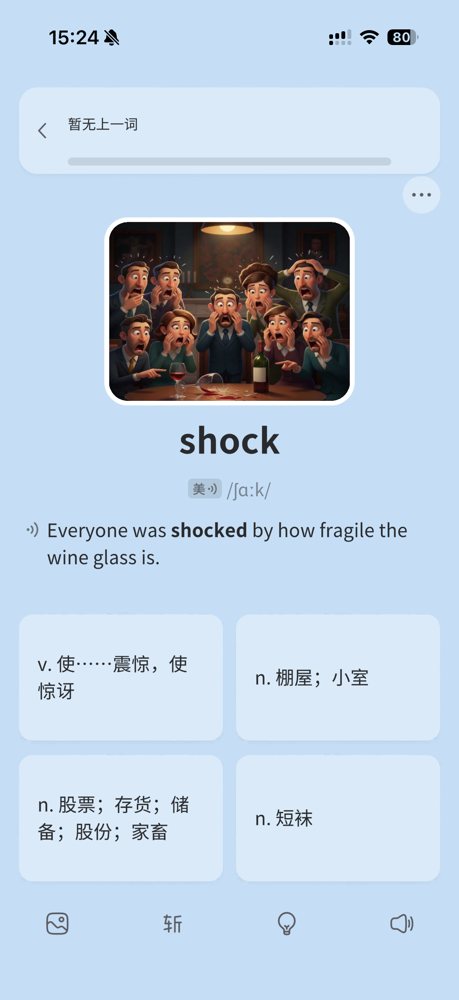<br><strong>核心背单词</strong></td>
<td width="25%">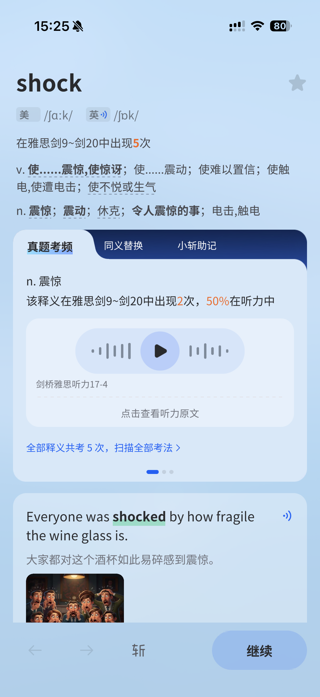<br><strong>单词展示</strong></td>
<td width="25%">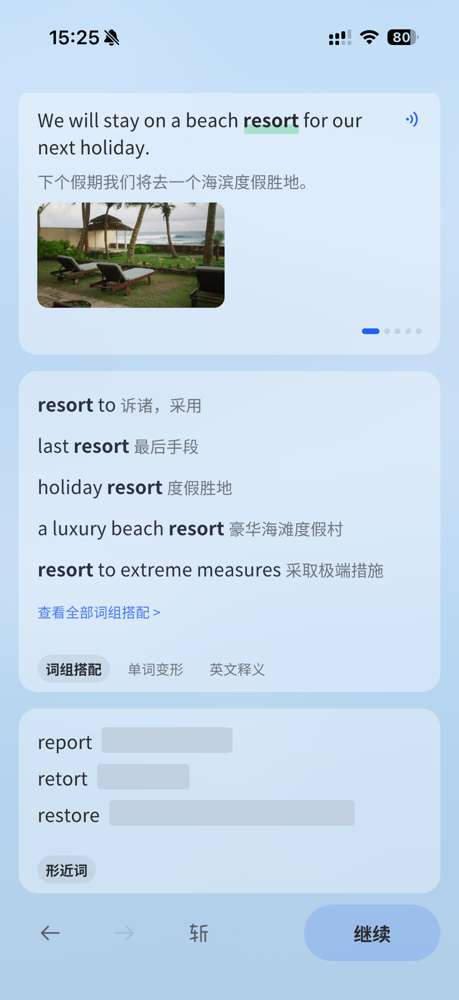<br><strong>单词展示 2</strong></td>
<td width="25%">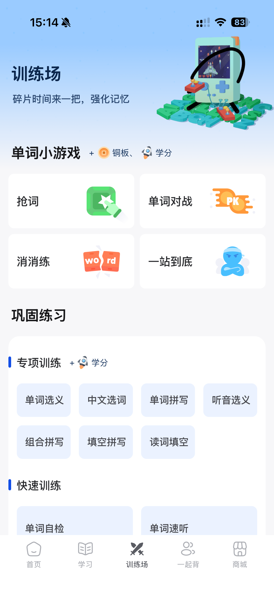<br><strong>训练场</strong></td>
</tr>
<tr>
<td width="25%">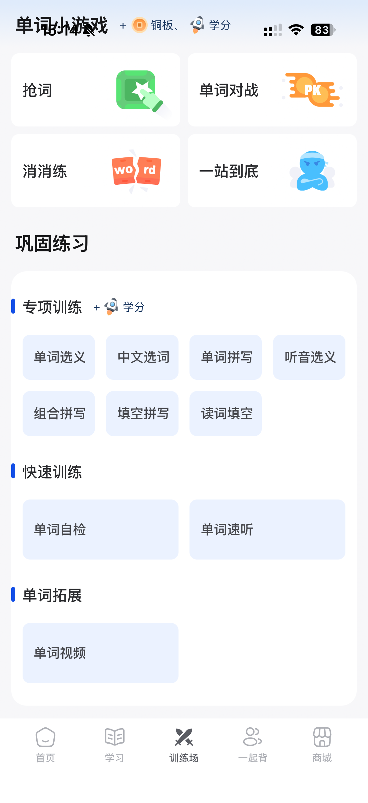<br><strong>训练场 2</strong></td>
<td width="25%">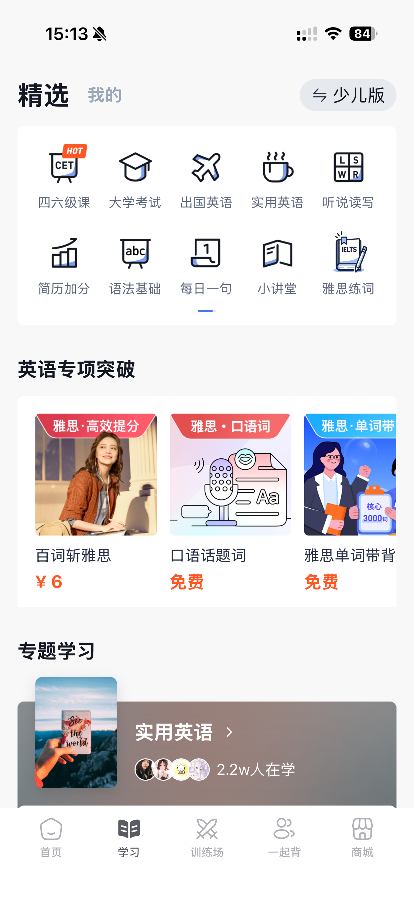<br><strong>学习</strong></td>
<td width="25%">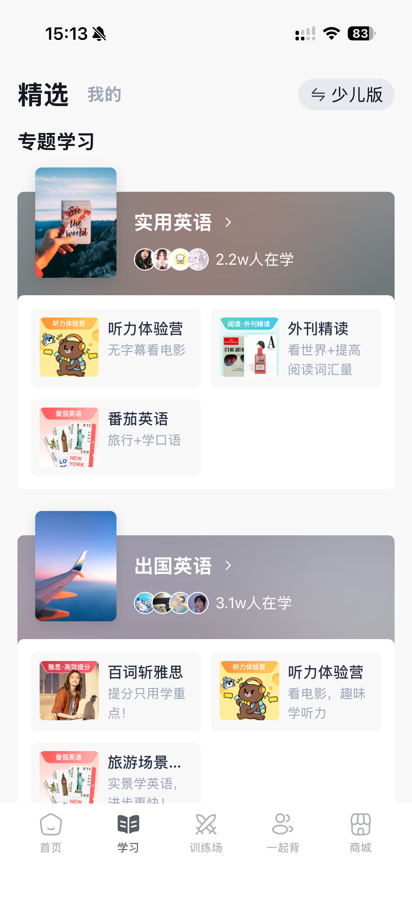<br><strong>学习 2</strong></td>
<td width="25%">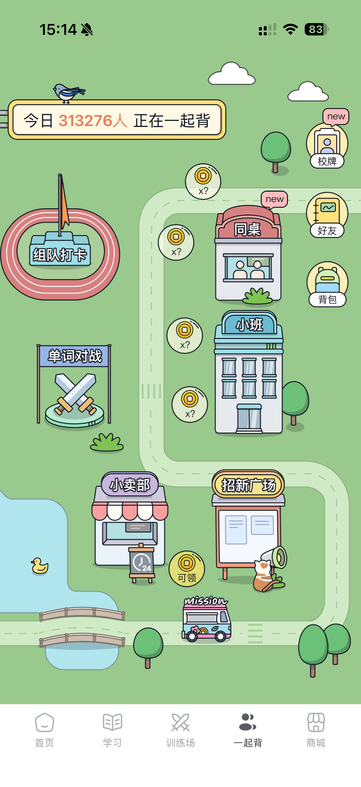<br><strong>一起背</strong></td>
</tr>
<tr>
<td width="25%">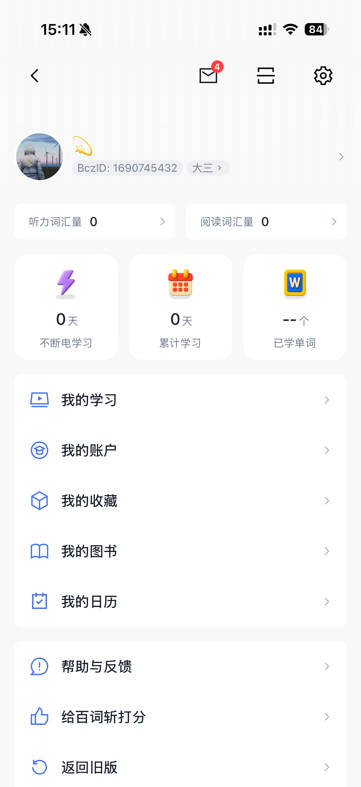<br><strong>个人主页</strong></td>
<td width="25%">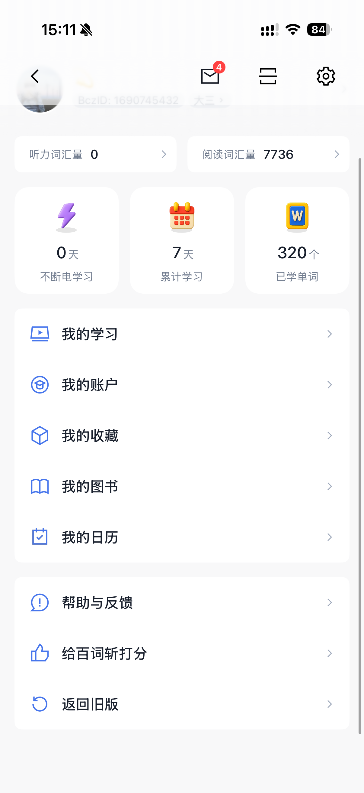<br><strong>个人主页 2</strong></td>
<td width="25%">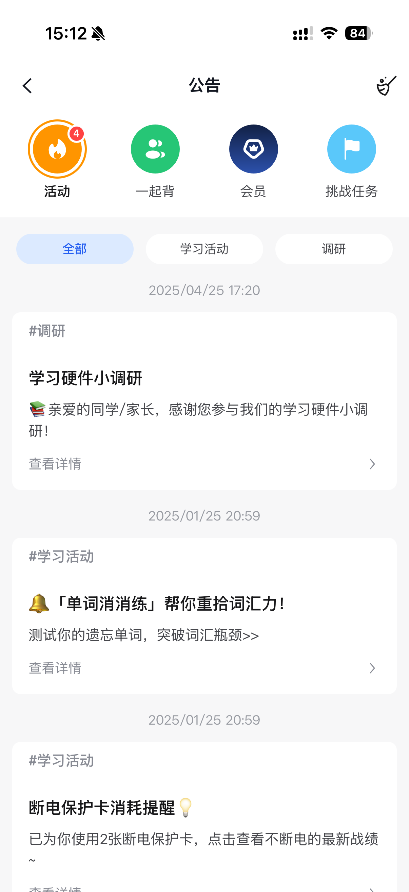<br><strong>消息</strong></td>
<td width="25%">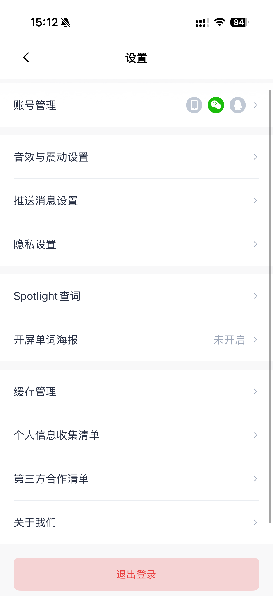<br><strong>设置</strong></td>
</tr>
</table>

### 3.2 产品逻辑

百词斩的产品逻辑是“把单词记忆变成图像化、游戏化、可探索的学习世界”。它的首页不是普通任务列表，而是以词汇星图作为视觉中心。单词节点如 `trim`、`eclipse`、`grind`、`pitch` 等被连接成网络，底部展示当前词书 `雅思核心`、进度 `20/3272 词`、`新学` 和 `复习` 入口。

这种首页表达的是“学习地图”而不是“今日待办”。用户看到的不只是今天的任务，还看到自己处在一张词汇网络中。页面左侧有任务和排行榜，右侧有查词、单词本、阅读、会员，底部有首页、学习、训练场、一起背、商城。百词斩的产品结构明显比不背单词更开放，用户可以在学习、训练、社交和消费之间切换。

`学习` 和 `学习2` 页面显示百词斩的内容平台属性：四六级课、大学考试、出国英语、实用英语、听说读写、简历加分、语法基础、每日一句、小讲堂、雅思练词，以及付费或免费专题内容。它不是只围绕一本词书，而是把不同英语能力和考试目标做成内容入口。

`训练场` 和 `训练场2` 则把记忆能力拆成多个玩法：抢词、单词对战、消消练、一站到底、单词选义、中文选词、单词拼写、听音选义、组合拼写、填空拼写、读词填空、单词自检、单词速听等。这里的产品逻辑是把复习拆成不同能力维度和游戏模式，而不是只让用户重复看同一张单词卡。

`一起背` 页面更像一个社交游戏地图。组队打卡、单词对战、同桌、小班、小卖部、招新广场、好友、背包、校牌等被做成建筑和道路。它把社交关系、奖励物品和学习任务场景化，让背单词有一种“进入校园/小镇”的感觉。

### 3.3 交互与使用链路

百词斩的主链路可以还原为：

```text
登录 -> 首页词汇地图 -> 新学/复习 -> 图片选义 -> 单词解释 -> 继续 -> 训练场强化 -> 一起背/排行榜/个人数据
```

`核心-背单词` 页面是百词斩最具识别度的交互。页面上方显示上一词进度，中间是大幅图片，图片下是单词 `shock`、音标和例句，然后是四个释义选项。底部还有图片、斩、提示、发音等工具图标。这里的核心不是先讲知识，而是先建立图片与词义的直觉连接。

`核心-单词展示` 和 `核心-单词展示2` 是解释态。它们补充考试出现次数、词性释义、真题考频、同义替换、小斩助记、听力内容、例句、图片等。也就是说，百词斩的学习节奏是先用图像让用户快速判断，再在解释页补上语言知识。图片承担记忆锚点，解释页承担知识校正。

交互上，百词斩比另外两款更强调连续点击和即时反馈。`继续` 按钮很大，底部“斩”图标具有品牌动作感，选项卡片面积大，图片占据屏幕中心。学习过程像一组连续卡片，用户不断判断、查看解释、继续下一词。

训练场中的入口采用网格卡片，每个玩法都有图标和名称。与扇贝的任务化列表不同，百词斩把练习包装成游戏菜单。不同训练项实际上对应不同输入输出形式：看英文选中文、看中文找英文、拼写、听音、填空、速听、自检、对战。前端需要根据玩法切换不同题型模板。

### 3.4 视觉、美术与界面风格

百词斩的视觉主轴是高识别度蓝色、卡通插画、地图场景和强游戏化图标。它的界面比不背单词和扇贝更“有画面”，几乎每个主要模块都有插画或图形化场景。

`登录页` 使用蓝色品牌背景，中间是百词斩 logo，底部是微信、QQ、Apple 等登录按钮。蓝色背景上有隐约单词纹理，品牌识别很强。与扇贝的风景图登录页不同，百词斩更强调应用自身的符号和色彩。

`首页` 使用浅蓝背景、词汇网络、浮动入口和大圆角底部卡片。蓝色是主品牌色，白色卡片负责承载任务，橙色和金币色用于奖励、任务和数字提示。页面空间层级较复杂：左侧任务和排行榜、右侧快捷工具、中心词汇网络、底部学习卡、底部导航同时存在。它不像不背单词那样让用户只看到两个入口，而是故意营造一个功能丰富的学习空间。

`核心-背单词` 页面使用大面积浅蓝背景，图片卡片放在视觉中心，单词和音标居中，选项卡片采用双列布局。图片的圆角、白色描边、轻阴影和卡片间距都在强调“可点击、可判断”。图片本身是卡通化场景，人物表情夸张，适合与 `shock` 这类情绪词建立强联想。

`核心-单词展示` 页面信息密度高，但仍保持蓝色主题。深蓝 tab、浅蓝卡片、绿色高亮、橙色考频共同构成多层级信息。顶部的单词大字和星标强化收藏，底部“继续”按钮保持学习流推进。这个页面的视觉不再是纯游戏，而是把考试信息、听力、例句和助记放在一个可滚动知识页里。

`训练场` 页面是典型游戏菜单视觉：顶部有大标题、说明文案和 3D 游戏机插画，下面是白色大卡片和浅蓝小按钮。图标采用明亮颜色和圆润形态，抢词、对战、消消练、一站到底等名称也带有游戏感。训练场的视觉价值在于把复习从“重复劳动”改写成“玩法选择”。

`一起背` 的美术风格最完整。它用绿色地图、道路、建筑、云朵、告示牌、金币、背包等元素组织社交功能。建筑图形有小班、同桌、小卖部、招新广场，右侧悬浮校牌、好友、背包。这种场景化 UI 对前端来说不是普通列表，而更接近地图式布局；对视觉来说，它把抽象功能变成可记忆的地点。

`学习` 页面是内容货架风格。顶部是功能宫格，下面是专题卡片和课程卡。付费价格、免费标签、人气数字、封面图、头像叠加共同构成内容平台视觉。`个人主页` 和 `个人主页2` 回到白底数据卡片，使用蓝色线性图标、统计卡和列表入口；`设置` 页面则采用标准系统设置列表，视觉克制很多。

百词斩的整体美术策略是用插画和场景建立品牌差异。缺点也很明显：视觉元素多，入口多，页面需要靠清晰层级控制注意力，否则用户容易在任务、训练、一起背、商城和会员之间分散。

### 3.5 前端与后端可观察到的工程结构

从前端角度，百词斩的复杂度主要来自多形态界面：词汇网络首页、图片题学习页、单词详情页、训练玩法网格、学习内容货架、一起背地图、个人统计页、设置页。它不仅有列表和卡片，还包含地图、节点网络、图像题、游戏入口、课程卡和社交建筑。

学习 session 至少包含：词卡生成、图片加载、音频播放、选项渲染、答题判断、解释展示、收藏、斩词、提示、继续、进度更新等状态。训练场则要求不同题型模板复用同一套词汇数据，但交互方式不同。

从后端角度，百词斩暴露出的数据对象包括：用户账号、个人资料、当前词书、词书进度、单词节点、词汇网络关系、图片素材、音频素材、例句、考试频次、听力真题、同义替换、助记内容、学习记录、复习组、训练模式记录、排行榜、任务、金币/学分、一起背社交关系、同桌/小班/好友、商城和会员权益。

它的数据结构比普通背词产品更重素材和玩法。每个单词不仅要有释义，还要有关联图片、音频、例句、考试信息和训练题模板。社交与奖励系统又引入排行榜、队伍、打卡、道具、货币和会员状态等数据。

## 4. 三个产品的横向分析

### 4.1 产品逻辑差异

| 维度     | 不背单词            | 扇贝               | 百词斩                  |
| ------ | --------------- | ---------------- | -------------------- |
| 用户动机假设 | 用户需要一个安静空间来持续背词 | 用户需要明确目标、计划和打卡反馈 | 用户需要图像刺激、玩法和社交感来保持兴趣 |
| 首页角色   | 学习启动页           | 今日任务控制台          | 学习地图与功能入口集合          |
| 学习材料组织 | 词书、词组、句库、笔记     | 词书、课程、AI、活动、个人数据 | 词书、图片题、训练场、学习内容、社交玩法 |
| 核心学习判断 | 先回忆，再看答案/选释义    | 先自评认识状态，再看解释     | 先看图选择，再看解释           |
| 完成反馈   | 数据沉淀相对安静        | 打卡、周进度、分享、活动任务   | 进度、奖励、训练、排行榜、一起背     |
| 扩展业务   | 课堂和内容较克制        | 课程、AI、发现页、会员     | 学习内容、训练场、一起背、商城      |

不背单词把用户视为一个需要沉浸学习的人；扇贝把用户视为一个有目标、可分层、可运营的学习者；百词斩把用户视为一个需要刺激、图像和玩法来保持学习的人。这三种假设直接决定了 UI 结构和视觉风格。

### 4.2 交互链路差异

| 阶段   | 不背单词           | 扇贝            | 百词斩              |
| ---- | -------------- | ------------- | ---------------- |
| 进入前  | 登录后加载词库        | 登录后连续建档       | 登录后进入品牌化学习世界     |
| 开始学习 | Learn / Review | 开始学习          | 新学 / 复习          |
| 题目前置 | 语境展示或回忆提示      | 认识/不认识自评      | 图片和例句直接进入选择      |
| 答题反馈 | 看答案、下一词、标熟     | 认识状态、词条解释、下一词 | 选项判断、斩、提示、继续     |
| 学后承接 | 仪表盘、我的内容       | 小结、打卡、分享、发现页  | 训练场、排行榜、一起背、个人数据 |

不背单词的链路最短，干扰最少。扇贝的链路最长，因为它在学习前和学习后都加入了计划、诊断、打卡和运营。百词斩的链路最丰富，因为它在学习之外保留了大量训练和社交玩法。

### 4.3 视觉与美术差异

| 视觉维度 | 不背单词          | 扇贝             | 百词斩               |
| ---- | ------------- | -------------- | ----------------- |
| 主色   | 粉蓝、灰白、橙色点缀    | 薄荷绿、浅黄、白色、橙色点缀 | 浅蓝、深蓝、白色、橙色/金币色点缀 |
| 背景   | 柔焦壁纸、浅灰底      | 浅绿渐变、运营页高饱和色   | 蓝色空间、地图、插画场景      |
| 卡片   | 半透明/白色大圆角，低阴影 | 白色圆角卡片，任务感强    | 大圆角卡片，游戏化和内容货架并存  |
| 字体   | 大号黑体，英文词极突出   | 标准现代中文，数据数字突出  | 大号英文词、粗标题、图形化标签   |
| 插画   | 少量、柔和、功能辅助    | 吉祥物和活动图标主要在运营页 | 高频插画、图片、地图和游戏图标   |
| 情绪   | 安静、私人、低压力     | 清爽、计划、轻运营      | 活泼、刺激、游戏化         |

不背单词的美术设计通过留白和低饱和度减少学习焦虑。扇贝通过浅绿色和任务卡建立计划感，同时在发现页释放运营活力。百词斩通过图像、地图和游戏图标建立强品牌记忆，但页面注意力也最分散。

### 4.4 前端复杂度对比

| 前端维度   | 不背单词               | 扇贝                    | 百词斩                     |
| ------ | ------------------ | --------------------- | ----------------------- |
| 主要组件   | 学习卡、设置列表、词条解释、仪表盘  | 问卷流、任务卡、学习页、打卡页、活动页   | 图片题、词汇地图、训练玩法、社交地图、内容货架 |
| 状态复杂度  | 学习设置和 session 状态丰富 | 用户画像、任务计划、运营活动状态丰富    | 多题型、多素材、多玩法、多社交状态丰富     |
| 视觉实现难点 | 透明卡片、排版层级、低干扰学习流   | 渐变背景、问卷流程、活动页与学习页风格切换 | 图像素材、地图布局、游戏化图标、节点网络    |
| 页面节奏   | 慢、静、连续             | 计划化、任务化               | 快、强反馈、多入口               |

三者都不是简单 CRUD 应用。前端需要处理学习 session 状态机、音频播放、词卡切换、进度同步、设置影响渲染、完成反馈和多模块导航。差异在于，不背单词偏学习状态，扇贝偏用户流程和运营状态，百词斩偏素材与玩法状态。

### 4.5 后端复杂度对比

| 后端维度 | 不背单词                   | 扇贝                            | 百词斩                            |
| ---- | ---------------------- | ----------------------------- | ------------------------------ |
| 核心数据 | 用户、词书、单词、词组、例句、学习记录、设置 | 用户画像、目标、词汇量、任务量、词书、学习记录、打卡、活动 | 用户、词书、图片素材、音频、例句、训练记录、社交、奖励、商城 |
| 复习依据 | 学习记录、熟词、生词、用户设置        | 认识/不认识、自评、任务量、打卡              | 答题结果、训练模式、复习组、游戏化进度            |
| 运营数据 | 较少                     | 很多，发现页、分享、会员、课程               | 很多，任务、排行榜、一起背、商城               |
| 内容资产 | 词汇知识内容深                | 词汇 + 课程 + AI + 活动             | 词汇 + 图片 + 音频 + 游戏玩法 + 社交资产     |

不背单词的后端重心是词汇知识和个性化学习配置。扇贝的后端重心是用户画像、任务计划、打卡运营和内容平台。百词斩的后端重心是多媒体词汇资产、训练玩法、社交关系和奖励系统。

## 5. 总结

不背单词、扇贝、百词斩都在解决“用户如何长期记单词”这个问题，但三个产品的答案不同。

不背单词用低干扰界面、清晰的 Learn/Review 入口、丰富词条解释和细颗粒度学习设置来建立个人学习空间。它的视觉像一本安静的数字词书，核心价值在于减少压力和保持沉浸。

扇贝用用户建档、目标选择、词汇量测试、任务量设置、打卡、分享和发现页任务，把背单词放进完整的学习运营闭环。它的视觉清爽但业务层级丰富，核心价值在于把用户目标转化为可追踪的每日计划。

百词斩用图片选义、词汇地图、训练场、一起背和游戏化奖励，把背单词做成更有刺激感和可玩性的学习体验。它的视觉最具品牌识别，核心价值在于用图像和玩法提升记忆参与度。

三者共同说明，成熟英语学习产品的 UI 并不是静态页面集合，而是由学习心理、内容资产、复习逻辑、交互反馈、视觉情绪和运营机制共同组成的系统。不同产品选择了不同权重：不背单词偏沉浸，扇贝偏计划，百词斩偏图像和游戏化。

