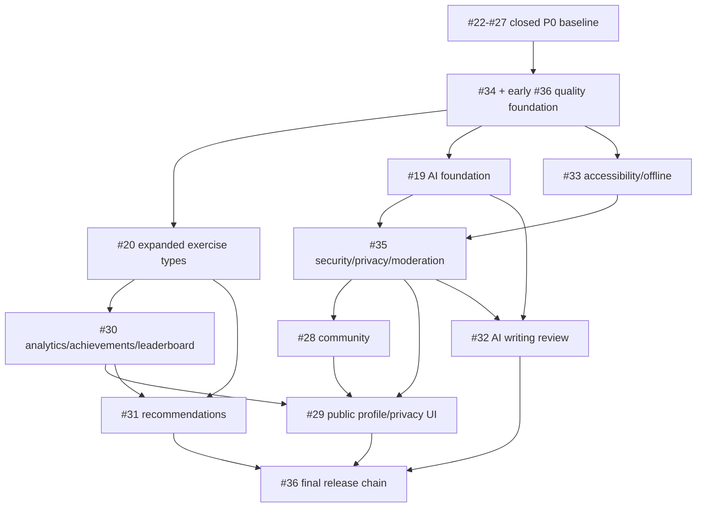

# Issue #19-#36 Implementation Roadmap

> **For agentic workers:** REQUIRED SUB-SKILL: Use `superpowers:subagent-driven-development` for implementation. This is a master roadmap, not a single feature patch. Each implementation batch below must be converted into its own detailed task plan before code is touched. Steps use checkbox (`- [ ]`) syntax for tracking.

**Goal:** Turn GitHub Issue #19-#36 plus `LinguaQuest_PRD_Development_Guide.md` into a concrete implementation sequence for the remaining LinguaQuest product work.

**Architecture:** Keep the existing two-project architecture: Flutter app in `linguaquest/` and Dart shelf server in `server/`. Closed P0 issues #22-#27 are treated as the persisted learning baseline and regression scope; open issues #19, #20, #28-#36 are implemented in dependency order with repository interfaces, mock repositories, API repositories, server routes, database migrations, UI screens, tests, and release checks moving together.

**Tech Stack:** Flutter 3.41.6, Dart 3.11.4, Riverpod, GoRouter, Dio, shared_preferences, flutter_local_notifications, audioplayers, shelf, shelf_router, postgres, dart_jsonwebtoken, GitHub Actions.

---

## Evidence

Issue inventory command:

```bash
gh issue list -R VonLan233/LinguaQuest --state all --limit 40 --json number,title,state,url --jq '.[] | select(.number>=19 and .number<=36) | "#\(.number) [\(.state)] \(.title)"'
```

Observed output:

```text
#36 [OPEN] REL-1: 补齐生产部署、环境配置和 Android 发布链路
#35 [OPEN] SEC-1: 补齐社区审核、举报、AI 安全和用户数据设置
#34 [OPEN] QA-1: 建立 CI、测试矩阵、截图资产和发布验收
#33 [OPEN] UX-1: 完成无障碍、音效/震动/高对比和离线体验
#32 [OPEN] P2-5: 完成 AI 作文批改、结构化输出和隐私说明
#31 [OPEN] P2-4: 实现个性化弱项分析和题型推荐
#30 [OPEN] P2-3: 实现排行榜、成就系统和学习分析真实数据
#29 [OPEN] P2-2: 实现个人空间、公开资料和隐私设置
#28 [OPEN] P2-1: 实现论坛社区生产闭环
#27 [CLOSED] P0-6: 合并并验收 API 后端/前端联动能力
#26 [CLOSED] P0-5: 补齐词典搜索与单词详情卡片内容质量
#25 [CLOSED] P0-4: 重构新学/复习 session 为混排、短间隔复现和错题回收
#24 [CLOSED] P0-3: 完整实现学习计划设置页
#23 [CLOSED] P0-2: 为目标词实现 UserWord 进度、掌握维度和复习队列
#22 [CLOSED] P0-1: 建立真实词书/词库数据与词书切换闭环
#20 [OPEN] P1-7: 扩展练习题型：听音选词、例句填空、易混词辨析。
#19 [OPEN] P1-6: 完成 AI 学习基础功能：知识问答、长难句分析、每日短文/情景填空，至少支持真实或 mock 功能。
```

Issue #21 classification:

```bash
gh pr view 21 -R VonLan233/LinguaQuest --json number,state,mergedAt,closedAt,url
```

Observed status:

```text
#21 state=CLOSED mergedAt=null
```

#21 is a closed, unmerged PR rather than an implemented baseline. Its claimed scope is not used as source-of-truth code. Valid product scope from #21 is mapped into the open issues in this roadmap: rewards and notifications remain regression scope from the current code and #27 baseline; AI maps to #19/#32/#35; community maps to #28/#35; analytics, leaderboards, and achievements map to #30; class/friend leaderboard dimensions map to #30.

Local architecture evidence:

```bash
find . -maxdepth 3 \( -name 'pubspec.yaml' -o -name 'analysis_options.yaml' -o -name 'docker-compose.yml' -o -name 'Dockerfile' \) -print | sort
```

Expected output contains:

```text
./linguaquest/analysis_options.yaml
./linguaquest/pubspec.yaml
./server/Dockerfile
./server/docker-compose.yml
./server/pubspec.yaml
```

Current dirty-worktree warning:

```text
 M .DS_Store
?? linguaquest/lib/assets/image/cozy_icons/
?? tools/
```

Do not stage these unless the active implementation batch explicitly owns them.

---

## Scope Decision

Issues #19-#36 cover multiple independent subsystems. Implementing them as one patch would repeat the rejected pattern from #21. The correct shape is a master roadmap plus separate implementation plans per batch:

1. Quality and release foundation: #34, early #36.
2. P1 learning expansion: #20.
3. AI foundation with minimum safety controls: #19.
4. Accessibility/offline/sensory settings: #33.
5. Security, privacy, and moderation foundation: #35.
6. Community production loop: #28.
7. Analytics, achievements, and global/friend/class leaderboard: #30.
8. Public profile and privacy UI: #29.
9. Personalized recommendation: #31.
10. AI writing correction: #32.
11. Final release chain: remaining #36.

Closed P0 issues #22-#27 are not reimplemented. They become regression checkpoints for every batch: wordbooks, UserWord, StudyPlan, session queue, dictionary detail, rewards/notifications currently present in the app/server, and API-backed app flow must stay green. Closed unmerged PR #21 is explicitly excluded as code baseline.

---

## File Ownership Map

### Shared Flutter App

- `linguaquest/lib/core/state/app_state.dart` - add durable state fields for AI history, community, analytics, privacy, accessibility, recommendations.
- `linguaquest/lib/core/state/app_controller.dart` - load, refresh, mutate new domains through repositories.
- `linguaquest/lib/core/constants/app_constants.dart` - API base URL and environment flags.
- `linguaquest/lib/core/routing/app_router.dart` - add concrete routes for AI tools, forum detail/compose, public profile, privacy/data settings.
- `linguaquest/lib/core/theme/app_tokens.dart` and `linguaquest/lib/core/theme/app_theme.dart` - high contrast and sensory-accessible UI tokens.
- `linguaquest/lib/l10n/app_en.arb`, `app_zh.arb`, `app_ms.arb` - user-facing strings for new production features.

### Flutter Data Layer

- Create `linguaquest/lib/data/models/ai_feature.dart`
- Create `linguaquest/lib/data/models/forum.dart`
- Create `linguaquest/lib/data/models/analytics.dart`
- Create `linguaquest/lib/data/models/achievement.dart`
- Create `linguaquest/lib/data/models/recommendation.dart`
- Create `linguaquest/lib/data/models/user_privacy.dart`
- Create `linguaquest/lib/data/repositories/ai_repository.dart`
- Create `linguaquest/lib/data/repositories/forum_repository.dart`
- Create `linguaquest/lib/data/repositories/analytics_repository.dart`
- Create `linguaquest/lib/data/repositories/profile_repository.dart`
- Modify `linguaquest/lib/data/repositories/api_repositories.dart`
- Modify `linguaquest/lib/data/repositories/mock_repositories.dart`
- Modify `linguaquest/lib/data/repositories/learning_repository.dart`

### Flutter Feature Screens

- `linguaquest/lib/features/training/training_session_screen.dart` - expanded exercise types and record payloads.
- `linguaquest/lib/features/quiz/quiz_session_screen.dart` - expanded question rendering if shared by formal lessons.
- `linguaquest/lib/features/study/session/session_queue_builder.dart` - question-type selection by mastery dimension.
- `linguaquest/lib/features/ai_learning/ai_learning_screen.dart` - replace "soon/planning" rows with real routes.
- `linguaquest/lib/features/quests/ai_tutor_screen.dart` - AI Q&A and long sentence analysis UI, or split into dedicated screens.
- Create `linguaquest/lib/features/ai_learning/ai_chat_screen.dart`
- Create `linguaquest/lib/features/ai_learning/ai_sentence_analysis_screen.dart`
- Create `linguaquest/lib/features/ai_learning/ai_cloze_screen.dart`
- Create `linguaquest/lib/features/ai_learning/ai_writing_review_screen.dart`
- `linguaquest/lib/features/discover/community_screen.dart` - replace static posts with repository-backed list.
- Create `linguaquest/lib/features/discover/forum_post_detail_screen.dart`
- Create `linguaquest/lib/features/discover/forum_compose_screen.dart`
- `linguaquest/lib/features/quests/leaderboard_screen.dart` - replace static entries with repository-backed leaderboard.
- `linguaquest/lib/features/quests/progress_analytics_screen.dart` - replace local-only metrics with analytics DTO.
- Create `linguaquest/lib/features/profile/public_profile_screen.dart`
- Create `linguaquest/lib/features/profile/privacy_settings_screen.dart`
- Create `linguaquest/lib/features/profile/data_settings_screen.dart`

### Server

- `server/lib/src/database.dart` - migrations/tables/query helpers for AI, forum, moderation, analytics, achievements, privacy, export.
- `server/lib/src/routes.dart` - new endpoints.
- Create `server/lib/src/ai_policy.dart`
- Create `server/lib/src/forum_policy.dart`
- Create `server/lib/src/moderation_policy.dart`
- Create `server/lib/src/analytics_policy.dart`
- Create `server/lib/src/achievement_policy.dart`
- Create `server/lib/src/recommendation_policy.dart`
- Create `server/lib/src/privacy_policy.dart`
- Modify `server/lib/src/config.dart` - AI provider, limits, Android/API release environment fields.
- Modify `server/bin/server.dart` - expose health/config validation messages without secrets.
- Modify `server/docker-compose.yml`, `server/docker-compose.prod.yml`, `server/Dockerfile`.

### Tests and CI

- Modify `.github/workflows/flutter-apk.yml`
- Create `server/test/ai_routes_test.dart`
- Create `server/test/forum_routes_test.dart`
- Create `server/test/moderation_policy_test.dart`
- Create `server/test/analytics_policy_test.dart`
- Create `server/test/recommendation_policy_test.dart`
- Create `server/test/privacy_policy_test.dart`
- Create `linguaquest/test/ai_learning_test.dart`
- Create `linguaquest/test/community_test.dart`
- Create `linguaquest/test/profile_privacy_test.dart`
- Create `linguaquest/test/analytics_recommendation_test.dart`
- Modify `linguaquest/test/session_queue_builder_test.dart`
- Modify `linguaquest/test/lesson_json_test.dart`
- Create `docs/release/android-release-checklist.md`
- Create `docs/screenshots/README.md`
- Create or update `linguaquest/test/ui_regression_test.dart`
- Modify `server/.env.example`

---

## Batch 0: Plan Split and Baseline Verification

**Issues:** supports all.

**Files:**
- Create: `docs/superpowers/plans/2026-06-17-issue-20-expanded-exercises.md`
- Create: `docs/superpowers/plans/2026-06-17-issue-19-ai-foundation.md`
- Create: `docs/superpowers/plans/2026-06-17-issue-33-accessibility-offline.md`
- Create: `docs/superpowers/plans/2026-06-17-issue-35-security-privacy.md`
- Create: `docs/superpowers/plans/2026-06-17-issue-28-community.md`
- Create: `docs/superpowers/plans/2026-06-17-issue-30-analytics-achievements-leaderboard.md`
- Create: `docs/superpowers/plans/2026-06-17-issue-29-public-profile.md`
- Create: `docs/superpowers/plans/2026-06-17-issue-31-recommendations.md`
- Create: `docs/superpowers/plans/2026-06-17-issue-32-ai-writing.md`
- Create: `docs/superpowers/plans/2026-06-17-issue-34-36-ci-release.md`

- [ ] **Step 1: Baseline dependency install**

Run:

```bash
cd /Users/lanyichen/Codes/Mobile/ASM2/linguaquest && flutter pub get
cd /Users/lanyichen/Codes/Mobile/ASM2/server && dart pub get
```

Expected output includes:

```text
Got dependencies!
```

- [ ] **Step 2: Baseline static/test checks**

Run:

```bash
cd /Users/lanyichen/Codes/Mobile/ASM2/linguaquest && flutter analyze
cd /Users/lanyichen/Codes/Mobile/ASM2/linguaquest && flutter test
cd /Users/lanyichen/Codes/Mobile/ASM2/server && dart test
```

Expected output includes:

```text
No issues found!
All tests passed!
```

If the existing worktree fails before any batch code changes, record the exact failure in the active batch plan and fix it first or mark it as a known inherited blocker.

- [ ] **Step 3: Create batch-level detailed plans**

Each batch plan must include exact failing tests first, implementation files, commands, expected failure text, expected pass text, and review checkpoints. No code implementation starts until its batch plan exists and has passed spec compliance review.

---

## Batch 1: Quality Foundation (#34 + early #36)

**Why first:** Later features add server routes, mobile state, AI, and community. CI and release smoke checks must exist before the blast radius grows.

**Files:**
- Modify: `.github/workflows/flutter-apk.yml`
- Modify: `server/.env.example`
- Create: `docs/release/android-release-checklist.md`
- Create: `docs/screenshots/README.md`
- Create or update: `linguaquest/test/ui_regression_test.dart`
- Modify: `server/README.md`
- Modify: `linguaquest/README.md`
- Modify: `server/lib/src/config.dart`
- Modify: `linguaquest/lib/core/constants/app_constants.dart`

**Implementation design:**
- GitHub Actions extends the existing `.github/workflows/flutter-apk.yml` instead of adding a competing workflow. It must trigger on `linguaquest/**`, `server/**`, and `.github/workflows/flutter-apk.yml`, then run Flutter pub/analyze/test, Dart server pub/test, and the existing release APK build.
- `server/.env.example` documents server config without secrets: database URL, database host/port/name/user/password where needed by compose/deploy scripts, JWT secret sample value, AI provider sample values, CORS/API host, log level.
- Flutter API base URL must be configurable with `--dart-define=API_BASE_URL=...` while preserving current demo behavior.
- Screenshot and style regression coverage is part of #34: create `docs/screenshots/README.md` with required screenshot asset naming and capture instructions, and add widget/golden-style regression tests for mobile width, dark mode where supported by the app theme, long text overflow, and core route smoke rendering.

**Verification commands:**

```bash
cd /Users/lanyichen/Codes/Mobile/ASM2/linguaquest && flutter analyze && flutter test
cd /Users/lanyichen/Codes/Mobile/ASM2/server && dart test
cd /Users/lanyichen/Codes/Mobile/ASM2/linguaquest && flutter test test/ui_regression_test.dart
cd /Users/lanyichen/Codes/Mobile/ASM2/linguaquest && flutter build apk --debug --dart-define=API_BASE_URL=http://10.0.2.2:8080
```

Expected output includes:

```text
No issues found!
All tests passed!
Built build/app/outputs/flutter-apk/app-debug.apk
```

**Review gate:**
- Spec compliance review: CI covers app/server tests, screenshot/style regression, screenshot asset instructions, and release docs mention env, secrets, Android build, smoke test.
- Code quality review: workflow caches are scoped safely, secrets are not printed, `server/.env.example` has no real credentials.

---

## Batch 2: Expanded Exercise Types (#20)

**Dependencies:** #22, #23, #25, #27 closed baseline.

**Files:**
- Modify: `linguaquest/lib/data/models/lesson.dart`
- Modify: `linguaquest/lib/data/models/exercise_record.dart`
- Modify: `linguaquest/lib/data/lesson_factory.dart`
- Modify: `linguaquest/lib/data/seed/seed_lessons.dart`
- Modify: `linguaquest/lib/features/study/session/session_queue_builder.dart`
- Modify: `linguaquest/lib/features/study/mixed_study_session_screen.dart`
- Modify: `linguaquest/lib/features/training/training_session_screen.dart`
- Modify: `linguaquest/lib/features/quiz/quiz_session_screen.dart`
- Modify: `server/lib/src/routes.dart`
- Modify: `server/lib/src/database.dart`
- Modify: `linguaquest/test/session_queue_builder_test.dart`
- Modify: `linguaquest/test/lesson_json_test.dart`
- Modify: `linguaquest/test/widget_test.dart`
- Modify: `server/test/routes_test.dart`

**Implementation design:**
- Add exercise types for `listeningWordChoice`, `listeningMeaningChoice`, `sentenceCloze`, `confusableChoice`, `collocationChoice`, and `derivativeChoice`.
- Preserve existing `QuizQuestionType.spelling` and choice-question immediate judgment behavior from `2026-06-17-quiz-immediate-judgment.md`.
- Add exercise-record fields that support #20 and the recommendation layer: `exerciseType`, `prompt`, `options`, `correctAnswer`, `userAnswer`, `isCorrect`, `responseTimeMs`, `confidence`, `wrongOption`, and `masteryDimension`.
- Update session queue selection so weak dimensions map to exercise types:
  - low `listeningScore` with word recognition goal -> listening word choice.
  - low `listeningScore` with meaning recognition goal -> listening meaning choice.
  - low `contextScore` -> sentence cloze/collocation.
  - low `meaningRecallScore` -> Chinese prompt to English choice.
  - confusable wrong options -> confusable choice.

**Test-first requirements:**
- Failing app tests must prove at least five non-basic question types can be built from real wordbook words.
- Failing server test must reject invalid exercise records and accept valid batch records containing the new `exerciseType` values.

**Verification commands:**

```bash
cd /Users/lanyichen/Codes/Mobile/ASM2/linguaquest && flutter test test/session_queue_builder_test.dart test/lesson_json_test.dart
cd /Users/lanyichen/Codes/Mobile/ASM2/linguaquest && flutter test test/widget_test.dart
cd /Users/lanyichen/Codes/Mobile/ASM2/server && dart test test/routes_test.dart
```

Expected output includes:

```text
All tests passed!
```

**Review gate:**
- Spec compliance review: #20 requires at least 7 total question types across learning/review/training, including both listening word choice and listening meaning choice, and complete exercise records for every answer.
- Code quality review: no duplicate question rendering branches when a shared widget/model can express the behavior.

---

## Batch 3: AI Foundation (#19)

**Dependencies:** #27 closed baseline. This batch must include minimum AI safety/failure handling itself; #35 expands that foundation for broader privacy, moderation, and data settings.

**Files:**
- Create: `server/lib/src/ai_policy.dart`
- Create: `server/test/ai_routes_test.dart`
- Modify: `server/lib/src/config.dart`
- Modify: `server/lib/src/database.dart`
- Modify: `server/lib/src/routes.dart`
- Create: `linguaquest/lib/data/models/ai_feature.dart`
- Create: `linguaquest/lib/data/repositories/ai_repository.dart`
- Modify: `linguaquest/lib/data/repositories/api_repositories.dart`
- Modify: `linguaquest/lib/data/repositories/mock_repositories.dart`
- Modify: `linguaquest/lib/core/state/app_state.dart`
- Modify: `linguaquest/lib/core/state/app_controller.dart`
- Modify: `linguaquest/lib/core/routing/app_router.dart`
- Modify: `linguaquest/lib/features/ai_learning/ai_learning_screen.dart`
- Create: `linguaquest/lib/features/ai_learning/ai_chat_screen.dart`
- Create: `linguaquest/lib/features/ai_learning/ai_sentence_analysis_screen.dart`
- Create: `linguaquest/lib/features/ai_learning/ai_cloze_screen.dart`
- Create: `linguaquest/test/ai_learning_test.dart`

**Implementation design:**
- Server owns all AI calls. App only calls `/ai/chat`, `/ai/sentence-analysis`, `/ai/cloze`, `/ai/history`, and `DELETE /ai/history/<id>`.
- `AiProvider` has `mock` and `remote` implementations selected by config. Mock is deterministic and used in tests.
- Minimum #19 safety is implemented here: input length limits, basic sensitive-content rejection, per-user daily request limits, provider timeout/retry handling, cost counter fields, and user-readable failure messages.
- Persist AI history with user ID, feature type, prompt, structured response, created time, and deleted flag.
- AI output is structured JSON:
  - Q&A: answer sections, cautions, related words.
  - Sentence analysis: main clause, clauses, modifiers, translation, vocabulary notes.
  - Cloze: passage, blanks, options, answer explanations.
- AI result never mutates learning progress directly. Cloze answers can create exercise records only through the normal answer flow.

**Verification commands:**

```bash
cd /Users/lanyichen/Codes/Mobile/ASM2/server && dart test test/ai_routes_test.dart
cd /Users/lanyichen/Codes/Mobile/ASM2/linguaquest && flutter test test/ai_learning_test.dart
cd /Users/lanyichen/Codes/Mobile/ASM2/server && dart test
cd /Users/lanyichen/Codes/Mobile/ASM2/linguaquest && flutter analyze && flutter test
```

Expected output includes:

```text
All tests passed!
No issues found!
```

**Review gate:**
- Spec compliance review: #19 requires at least two AI features end-to-end plus no API key leakage, input limits, sensitive-content handling, cost/rate limits, retry/failure feedback, and deletable history; this batch implements three with mock provider and server proxy.
- Code quality review: prompt construction, provider calls, persistence, and UI rendering are separated.

---

## Batch 4: Accessibility, Sensory Settings, and Offline UX (#33)

**Files:**
- Modify: `linguaquest/lib/core/state/app_state.dart`
- Modify: `linguaquest/lib/core/state/app_controller.dart`
- Modify: `linguaquest/lib/core/theme/app_tokens.dart`
- Modify: `linguaquest/lib/core/theme/app_theme.dart`
- Modify: `linguaquest/lib/features/profile/settings_screen.dart`
- Modify: `linguaquest/lib/features/study/mixed_study_session_screen.dart`
- Modify: `linguaquest/lib/features/quiz/quiz_session_screen.dart`
- Modify: `linguaquest/lib/features/training/training_session_screen.dart`
- Modify: `linguaquest/lib/services/local_notification_service.dart`
- Modify: `linguaquest/lib/data/wordbook_asset_loader.dart`
- Create: `linguaquest/test/accessibility_settings_test.dart`

**Implementation design:**
- Add settings for sound, vibration, high contrast, and offline-only warning state.
- Use non-color feedback in answer buttons: icon, label, semantics, and shape/border state.
- Wordbook data remains available offline from bundled assets. AI and remote-only features show a clear online-required state.
- Audio pronunciation failures show retry and fallback text without blocking the session.

**Verification commands:**

```bash
cd /Users/lanyichen/Codes/Mobile/ASM2/linguaquest && flutter test test/accessibility_settings_test.dart
cd /Users/lanyichen/Codes/Mobile/ASM2/linguaquest && flutter analyze && flutter test
```

Expected output includes:

```text
All tests passed!
No issues found!
```

**Review gate:**
- Spec compliance review: #33 covers small screen, high contrast, sound/vibration switches, non-color answer feedback, offline wordbook learning, and AI online prompt.
- Code quality review: settings are persisted once and read through state, not scattered through widget-local flags.

---

## Batch 5: Security, Privacy, and Moderation Foundation (#35)

**Dependencies:** before #28 community production, #29 public profile, #32 writing review.

**Files:**
- Create: `server/lib/src/moderation_policy.dart`
- Create: `server/lib/src/privacy_policy.dart`
- Create: `server/test/moderation_policy_test.dart`
- Create: `server/test/privacy_policy_test.dart`
- Modify: `server/lib/src/ai_policy.dart`
- Modify: `server/lib/src/database.dart`
- Modify: `server/lib/src/routes.dart`
- Create: `linguaquest/lib/data/models/user_privacy.dart`
- Create: `linguaquest/lib/features/profile/privacy_settings_screen.dart`
- Create: `linguaquest/lib/features/profile/data_settings_screen.dart`
- Modify: `linguaquest/lib/core/routing/app_router.dart`
- Modify: `linguaquest/lib/features/profile/settings_screen.dart`
- Create: `linguaquest/test/profile_privacy_test.dart`

**Implementation design:**
- Add AI input length limits, per-user daily request limits, feature-level cost counters, and deterministic block messages.
- Add delete/list AI history endpoints.
- Add community content statuses: `pending`, `approved`, `rejected`, `hidden`.
- Add report reason/status model for posts and comments.
- Add user privacy flags: public study stats, public streak, public wordbook, public posts.
- Add data settings: clear local cache, export account data, delete-account explanation.

**Verification commands:**

```bash
cd /Users/lanyichen/Codes/Mobile/ASM2/server && dart test test/moderation_policy_test.dart test/privacy_policy_test.dart test/ai_routes_test.dart
cd /Users/lanyichen/Codes/Mobile/ASM2/linguaquest && flutter test test/profile_privacy_test.dart test/ai_learning_test.dart
cd /Users/lanyichen/Codes/Mobile/ASM2/server && dart test
cd /Users/lanyichen/Codes/Mobile/ASM2/linguaquest && flutter analyze && flutter test
```

Expected output includes:

```text
All tests passed!
No issues found!
```

**Review gate:**
- Spec compliance review: #35 requires AI safety, AI history deletion, data settings, community moderation/reporting, privacy fields.
- Code quality review: policy code is testable without HTTP; routes only parse/auth/serialize.

---

## Batch 6: Forum Community Production Loop (#28)

**Dependencies:** #35.

**Files:**
- Create: `server/lib/src/forum_policy.dart`
- Create: `server/test/forum_routes_test.dart`
- Modify: `server/lib/src/database.dart`
- Modify: `server/lib/src/routes.dart`
- Create: `linguaquest/lib/data/models/forum.dart`
- Create: `linguaquest/lib/data/repositories/forum_repository.dart`
- Modify: `linguaquest/lib/data/repositories/api_repositories.dart`
- Modify: `linguaquest/lib/data/repositories/mock_repositories.dart`
- Modify: `linguaquest/lib/core/state/app_state.dart`
- Modify: `linguaquest/lib/core/state/app_controller.dart`
- Modify: `linguaquest/lib/core/routing/app_router.dart`
- Modify: `linguaquest/lib/features/discover/community_screen.dart`
- Create: `linguaquest/lib/features/discover/forum_post_detail_screen.dart`
- Create: `linguaquest/lib/features/discover/forum_compose_screen.dart`
- Create: `linguaquest/test/community_test.dart`

**Implementation design:**
- Endpoints: list posts, create post, get detail, create comment, like/unlike, favorite/unfavorite, report post/comment.
- Newly created content enters `pending` unless moderation policy auto-approves safe content in mock/local mode.
- Reward event `forumInteraction` is recorded only after approved post/comment.
- Notifications are created for comment/like events where appropriate.
- Public-profile linkage is included in the data contract: approved author posts and favorited/liked content must be queryable for Batch 8 personal-space rendering. #28 is not considered product-complete until that linkage is consumed by Batch 8.

**Verification commands:**

```bash
cd /Users/lanyichen/Codes/Mobile/ASM2/server && dart test test/forum_routes_test.dart test/moderation_policy_test.dart
cd /Users/lanyichen/Codes/Mobile/ASM2/linguaquest && flutter test test/community_test.dart
cd /Users/lanyichen/Codes/Mobile/ASM2/server && dart test
cd /Users/lanyichen/Codes/Mobile/ASM2/linguaquest && flutter analyze && flutter test
```

Expected output includes:

```text
All tests passed!
No issues found!
```

**Review gate:**
- Spec compliance review: #28 requires post list, detail, compose, comments, like, favorite, report, moderation, notification/task links, plus a public-profile data path for user-authored approved posts.
- Code quality review: forum DTOs do not leak private user fields and content status is enforced server-side.

---

## Batch 7: Analytics, Achievements, and Leaderboard (#30)

**Dependencies:** #20 improves exercise records; #23/#25 closed baseline.

**Files:**
- Create: `server/lib/src/analytics_policy.dart`
- Create: `server/lib/src/achievement_policy.dart`
- Create: `server/test/analytics_policy_test.dart`
- Modify: `server/lib/src/database.dart`
- Modify: `server/lib/src/routes.dart`
- Create: `linguaquest/lib/data/models/analytics.dart`
- Create: `linguaquest/lib/data/models/achievement.dart`
- Create: `linguaquest/lib/data/repositories/analytics_repository.dart`
- Modify: `linguaquest/lib/data/repositories/api_repositories.dart`
- Modify: `linguaquest/lib/data/repositories/mock_repositories.dart`
- Modify: `linguaquest/lib/core/state/app_state.dart`
- Modify: `linguaquest/lib/core/state/app_controller.dart`
- Modify: `linguaquest/lib/features/quests/progress_analytics_screen.dart`
- Modify: `linguaquest/lib/features/quests/leaderboard_screen.dart`
- Modify: `linguaquest/lib/features/quests/quest_screen.dart`
- Create: `linguaquest/test/analytics_recommendation_test.dart`

**Implementation design:**
- Analytics DTO exposes at least 12 PRD metrics: streak days, total study days, learned words, mastered words, new-word count, review count, current wordbook progress, today minutes, total minutes, average accuracy, 7-day trend, weakest exercise type, most missed words, achievement count, training XP/rank.
- Leaderboards are server-computed by weekly XP and support `global`, `friends`, and `class` dimensions. If friends/classes do not yet have full social graph membership, this batch must still expose deterministic mock/local membership and API DTOs so the UI and policy contract are real rather than hard-coded.
- Achievements are rule-based and idempotent.

**Verification commands:**

```bash
cd /Users/lanyichen/Codes/Mobile/ASM2/server && dart test test/analytics_policy_test.dart
cd /Users/lanyichen/Codes/Mobile/ASM2/linguaquest && flutter test test/analytics_recommendation_test.dart
cd /Users/lanyichen/Codes/Mobile/ASM2/server && dart test
cd /Users/lanyichen/Codes/Mobile/ASM2/linguaquest && flutter analyze && flutter test
```

Expected output includes:

```text
All tests passed!
No issues found!
```

**Review gate:**
- Spec compliance review: #30 requires real global/friend/class leaderboard dimensions, achievements, and 12+ analytics metrics.
- Code quality review: metric definitions are centralized in policy code, not duplicated in UI.

---

## Batch 8: Public Profile and Privacy UI (#29)

**Dependencies:** #28, #30, #35.

**Files:**
- Create: `linguaquest/lib/features/profile/public_profile_screen.dart`
- Modify: `linguaquest/lib/features/profile/profile_screen.dart`
- Modify: `linguaquest/lib/features/home/home_screen.dart`
- Modify: `linguaquest/lib/core/routing/app_router.dart`
- Create: `linguaquest/lib/data/repositories/profile_repository.dart`
- Modify: `linguaquest/lib/data/repositories/api_repositories.dart`
- Modify: `linguaquest/lib/data/repositories/mock_repositories.dart`
- Modify: `server/lib/src/database.dart`
- Modify: `server/lib/src/routes.dart`
- Create: `server/test/profile_routes_test.dart`
- Modify: `linguaquest/test/profile_privacy_test.dart`

**Implementation design:**
- Avatar entry on home and profile routes to the same public profile page.
- Public profile shows only fields allowed by privacy settings: intro, achievement badges, streak, public stats, approved posts, public favorites.
- Owner view shows edit/privacy shortcuts; other-user view hides private data and destructive actions.

**Verification commands:**

```bash
cd /Users/lanyichen/Codes/Mobile/ASM2/server && dart test test/profile_routes_test.dart test/privacy_policy_test.dart
cd /Users/lanyichen/Codes/Mobile/ASM2/server && dart test
cd /Users/lanyichen/Codes/Mobile/ASM2/linguaquest && flutter test test/profile_privacy_test.dart
cd /Users/lanyichen/Codes/Mobile/ASM2/linguaquest && flutter analyze && flutter test
```

Expected output includes:

```text
All tests passed!
No issues found!
```

**Review gate:**
- Spec compliance review: #29 requires profile, achievements, public data, posts/favorites, privacy control.
- Code quality review: public DTO construction happens server-side; UI does not filter private data after receiving it.

---

## Batch 9: Personalized Weakness Analysis and Recommendations (#31)

**Dependencies:** #20, #30.

**Files:**
- Create: `server/lib/src/recommendation_policy.dart`
- Create: `server/test/recommendation_policy_test.dart`
- Modify: `server/lib/src/routes.dart`
- Create: `linguaquest/lib/data/models/recommendation.dart`
- Modify: `linguaquest/lib/data/repositories/analytics_repository.dart`
- Modify: `linguaquest/lib/data/repositories/api_repositories.dart`
- Modify: `linguaquest/lib/data/repositories/mock_repositories.dart`
- Modify: `linguaquest/lib/features/quests/progress_analytics_screen.dart`
- Modify: `linguaquest/lib/features/study/session/session_queue_builder.dart`
- Modify: `linguaquest/test/analytics_recommendation_test.dart`
- Modify: `linguaquest/test/session_queue_builder_test.dart`

**Implementation design:**
- Recommendations consume exercise records, six mastery dimensions, wrong options, response time, and study plan deadline.
- Each recommendation has `targetWordIds`, `exerciseType`, `reason`, `priority`, and `estimatedMinutes`.
- UI shows the reason in plain language and starts a targeted practice session using existing session queue mechanics.

**Verification commands:**

```bash
cd /Users/lanyichen/Codes/Mobile/ASM2/server && dart test test/recommendation_policy_test.dart test/analytics_policy_test.dart
cd /Users/lanyichen/Codes/Mobile/ASM2/server && dart test
cd /Users/lanyichen/Codes/Mobile/ASM2/linguaquest && flutter test test/analytics_recommendation_test.dart test/session_queue_builder_test.dart
cd /Users/lanyichen/Codes/Mobile/ASM2/linguaquest && flutter analyze && flutter test
```

Expected output includes:

```text
All tests passed!
No issues found!
```

**Review gate:**
- Spec compliance review: #31 requires explainable recommendations that change after answer behavior changes.
- Code quality review: recommendation policy is deterministic in tests and has sensible sparse-data fallback.

---

## Batch 10: AI Writing Review (#32)

**Dependencies:** #19, #35.

**Files:**
- Modify: `server/lib/src/ai_policy.dart`
- Modify: `server/test/ai_routes_test.dart`
- Modify: `linguaquest/lib/data/models/ai_feature.dart`
- Modify: `linguaquest/lib/data/repositories/ai_repository.dart`
- Modify: `linguaquest/lib/data/repositories/api_repositories.dart`
- Modify: `linguaquest/lib/data/repositories/mock_repositories.dart`
- Modify: `linguaquest/lib/features/ai_learning/ai_learning_screen.dart`
- Create: `linguaquest/lib/features/ai_learning/ai_writing_review_screen.dart`
- Create: `linguaquest/test/ai_writing_review_test.dart`
- Modify: `linguaquest/lib/features/profile/data_settings_screen.dart`

**Implementation design:**
- Writing review request contains exam type, prompt, essay body, target score/current level.
- Structured result contains total score, rubric scores, main issues, paragraph suggestions, high-score expressions, grammar issues, and rewritten sample.
- Server enforces length, privacy, rate, and cost limits from #35.
- History can be listed and deleted with the same AI history model from #19.

**Verification commands:**

```bash
cd /Users/lanyichen/Codes/Mobile/ASM2/server && dart test test/ai_routes_test.dart test/privacy_policy_test.dart
cd /Users/lanyichen/Codes/Mobile/ASM2/linguaquest && flutter test test/ai_writing_review_test.dart test/ai_learning_test.dart
cd /Users/lanyichen/Codes/Mobile/ASM2/server && dart test
cd /Users/lanyichen/Codes/Mobile/ASM2/linguaquest && flutter analyze && flutter test
```

Expected output includes:

```text
All tests passed!
No issues found!
```

**Review gate:**
- Spec compliance review: #32 requires complete scoring report, history delete, and privacy notice.
- Code quality review: long model response rendering is structured, scrollable, and resilient to missing optional sections.

---

## Batch 11: Final Release Chain (#36)

**Dependencies:** #34 and all feature batches planned for release.

**Files:**
- Modify: `.github/workflows/flutter-apk.yml`
- Modify: `server/.env.example`
- Modify: `server/docker-compose.prod.yml`
- Modify: `server/deploy/vps_deploy.sh`
- Modify: `server/README.md`
- Modify: `linguaquest/README.md`
- Modify: `docs/release/android-release-checklist.md`
- Modify: `linguaquest/android/app/build.gradle.kts`
- Create: `docs/release/smoke-test.md`

**Implementation design:**
- Server deployment docs cover migration, backup, logs, health check, and rollback.
- Android release docs cover keystore generation, local secure storage, `key.properties`, AAB/APK build, and API base URL.
- Smoke test covers register/login, choose wordbook, learning session, review session, reward claim, notification, AI mock/remote mode, community post, privacy settings, analytics page.

**Verification commands:**

```bash
cd /Users/lanyichen/Codes/Mobile/ASM2/server && dart test
cd /Users/lanyichen/Codes/Mobile/ASM2/server && docker compose up -d --build
curl -i http://localhost:8080/health
cd /Users/lanyichen/Codes/Mobile/ASM2/server && docker compose down
```

Expected output includes:

```text
HTTP/1.1 200 OK
{"status":"ok"}
```

Android build:

```bash
cd /Users/lanyichen/Codes/Mobile/ASM2/linguaquest && flutter build apk --release --dart-define=API_BASE_URL=https://example.com
```

Expected output includes:

```text
Built build/app/outputs/flutter-apk/app-release.apk
```

**Review gate:**
- Spec compliance review: #36 release checklist can be followed by a new developer without hidden credentials.
- Code quality review: no signing secrets, JWT secrets, database passwords, or AI keys are committed.

---

## Global Verification Contract

Before any batch is marked complete, run and paste actual output:

```bash
cd /Users/lanyichen/Codes/Mobile/ASM2/linguaquest && flutter analyze
cd /Users/lanyichen/Codes/Mobile/ASM2/linguaquest && flutter test
cd /Users/lanyichen/Codes/Mobile/ASM2/server && dart test
```

Before release-related completion claims, also run and paste actual output:

```bash
cd /Users/lanyichen/Codes/Mobile/ASM2/linguaquest && flutter build apk --release
```

For server availability claims, run and paste actual output:

```bash
curl -i http://localhost:8080/health
```

For each batch:

1. Write failing tests first.
2. Run the failing test and paste the failure.
3. Implement the minimal complete production code.
4. Run the focused tests and paste the pass output.
5. Run full app/server checks and paste output.
6. Run spec compliance review.
7. Fix review findings.
8. Re-run spec compliance review.
9. Run code quality review.
10. Fix review findings.
11. Re-run code quality review.
12. Commit only files owned by the batch.

---

## Dependency Graph



---

## Self-Review

### Spec Coverage

- #19 covered by Batch 3.
- #20 covered by Batch 2.
- #22-#27 are closed and covered as baseline regression scope.
- #28 covered by Batch 6 for community mechanics and completed with Batch 8 for personal-space display linkage.
- #29 covered by Batch 8.
- #30 covered by Batch 7, including global/friend/class leaderboard dimensions.
- #31 covered by Batch 9.
- #32 covered by Batch 10.
- #33 covered by Batch 4.
- #34 covered by Batch 1.
- #35 covered by Batch 5.
- #36 covered by Batch 1 and Batch 11.

### Placeholder Scan

This roadmap intentionally avoids code-level omissions. It does not include implementation snippets for every feature because the writing-plans skill requires this scope to be split into batch-specific plans first. Each batch plan must contain exact tests and code before implementation begins.

### Type and Boundary Consistency

- Frontend additions follow the existing `model -> repository interface -> mock/api repositories -> AppController/AppState -> feature screen` pattern.
- Server additions follow the existing `policy -> database helper -> route -> test` pattern.
- Existing P0 data surfaces are preserved as dependencies rather than rewritten.
